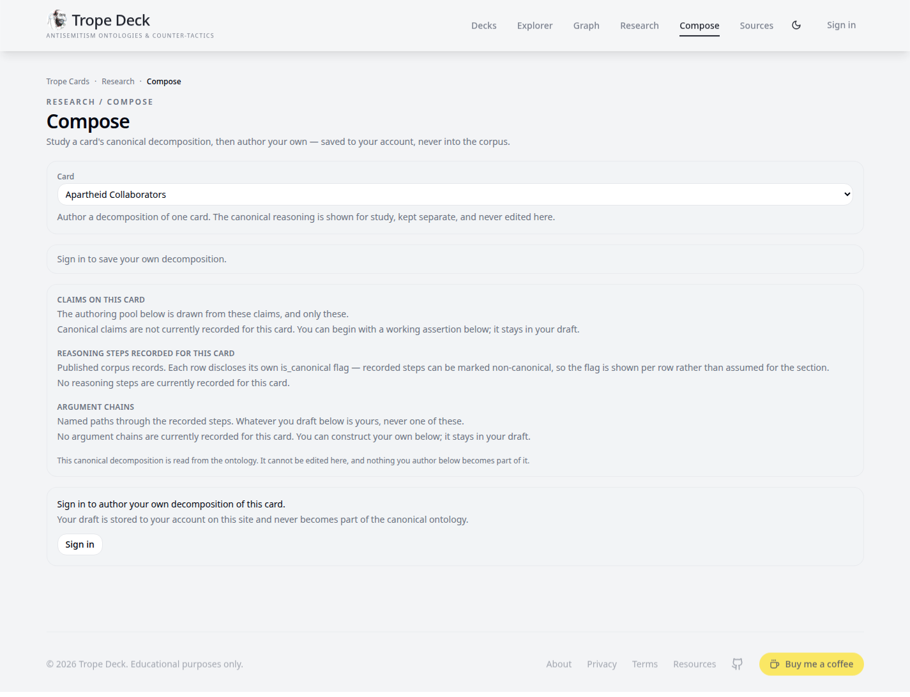
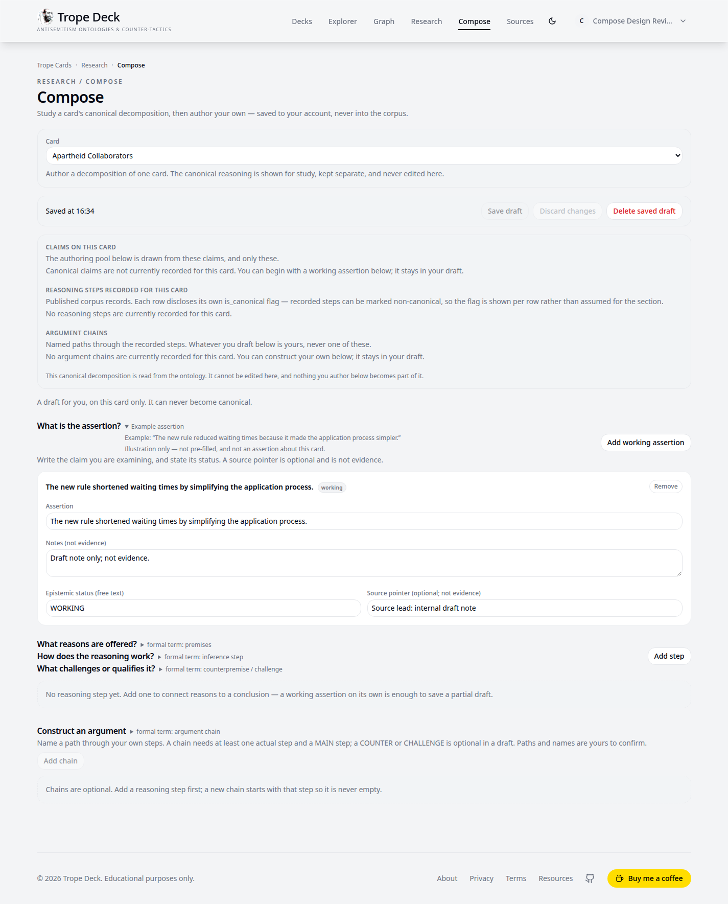
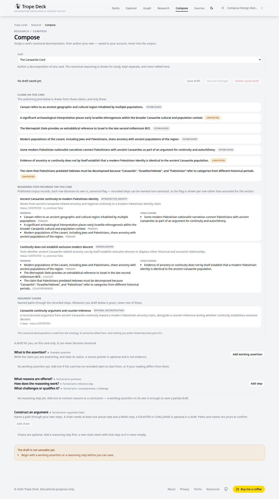
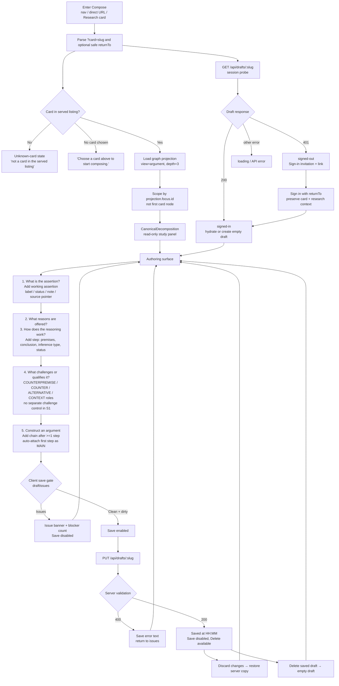
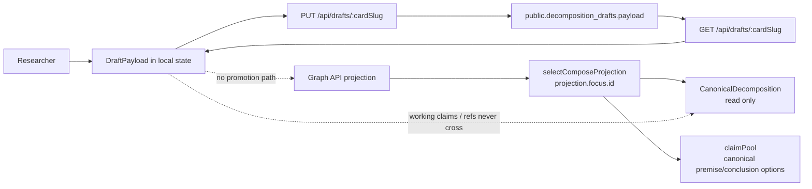

# Compose page — UI/UX design review handoff

**Status:** design review input for the shipped S0/S1 Compose workflow (Issue #16). This document describes current behaviour; it is not a new spec decision and does not authorize S2–S4.

**Purpose:** give a UI/UX reviewer everything needed to pick up the page: product intent, full step flow, every data/UI type, exact copy, states, screenshots, and focused review questions.

**Implementation authority:** `src/pages/Compose.tsx`, `src/compose/*`, `server/api/drafts.ts`, `server/composition/draft-contract.ts`, `SPEC.md` §9.5, `ROADMAP.md` Milestone 4.

**Figma reference:** Compose / Decompose node `7:5057` (per `ROADMAP.md`). The screenshots below are the authority for **shipped behaviour**.

---

## 1. What the page is for

Compose is a researcher authoring surface over **one card at a time**. Its central invariant is strict separation:

| Surface | Canonical corpus | Researcher draft |
|---|---|---|
| Source | card-focused graph projection | `public.decomposition_drafts.payload` JSON |
| Editable here? | No | Yes |
| Visible in authoring pool? | Yes, as premise/conclusion options | Yes, as `working` refs |
| Visible in graph/API/cards/counts? | Yes | **Never** |
| Promotion path to canonical? | — | None |

The researcher first reads what is recorded for the card, then writes a private, account-owned decomposition. If the card has no canonical claim, the UI says so honestly and lets the researcher start with a **working assertion**.

Approved plain-language prompts, in order:

1. **What is the assertion?**
2. **What reasons are offered?**
3. **How does the reasoning work?**
4. **What challenges or qualifies it?**
5. **Construct an argument**

Formal ontology terms remain available through `<details>` disclosures. The assertion prompt uniquely shows a concrete example instead of an ontology explanation.

---

## 2. Screenshot index

Captured locally against `http://localhost:8080` (Vite) + `http://localhost:3001` (Express) on 2026-11-23. Desktop captures: 1440×1000 viewport, full page. Mobile capture: 375×812 viewport, full page. No production credentials or deployed account data appear.

| # | File | State |
|---|---|---|
| 01 | [`01-signed-out-gate.png`](compose/screenshots/01-signed-out-gate.png) | Signed out, card selected: read-only corpus visible; authoring gated behind sign-in |
| 02 | [`02-zero-claim-empty.png`](compose/screenshots/02-zero-claim-empty.png) | Signed in, zero-claim card, empty draft, example disclosure expanded |
| 03 | [`03-working-assertion-saved.png`](compose/screenshots/03-working-assertion-saved.png) | One saved working assertion; no steps/chains yet |
| 04 | [`04-step-and-chain.png`](compose/screenshots/04-step-and-chain.png) | Developed draft: working assertion + reasoning step + named chain, saved |
| 05 | [`05-populated-canonical.png`](compose/screenshots/05-populated-canonical.png) | Populated canonical card (`canaanite-card`), read-only panel plus empty draft |
| 06 | [`06-mobile-375.png`](compose/screenshots/06-mobile-375.png) | 375px stacked layout, signed in, zero-claim card, empty draft |

### 01 — Signed-out gate



### 02 — Zero-claim empty state


### 03 — Saved working assertion



### 04 — Step and chain authoring


### 05 — Populated canonical read panel



### 06 — Mobile 375px


---

## 3. Information architecture / screen anatomy

Render order is deliberate: **choose card → understand recorded reasoning → author your own**.

```
PageShell / PageBreadcrumb / PageHeading
└── Card picker section                 "Choose a card"
    ├── Card <select>                  "Pick a card…"
    ├── Optional "Back to research"
    └── Separation explainer
└── ComposeWorkspace                    keyed by active card slug
    ├── SaveBar                        status + blockers + Save/Discard/Delete
    ├── CanonicalDecomposition         read-only study panel
    └── PermissionGate
        └── ComposeEditor
            ├── Working assertion section
            ├── Reasoning step section
            ├── Argument chain section
            └── Unsavedable-issues banner
```

### Shared page chrome

- Route: `/research/compose`
- Header nav: `Compose` (exact active match)
- Entry from Research workspace: card row → `Compose` (`?card=<slug>&returnTo=<safe path>`)
- Breadcrumb: `Trope Cards · Research · Compose`
- Heading: `Research / Compose`
- Description: `Study a card's canonical decomposition, then author your own — saved to your account, never into the corpus.`
- Geometry: shared `PageShell` container, `pt-24 pb-16`, theme-aware `bg-muted`, aligned header/main/footer edges.

### Component inventory

| Component | File | Responsibility |
|---|---|---|
| `Compose` | `src/pages/Compose.tsx` | URL state, card choice, queries, auth probe, workspace keying |
| `ComposeWorkspace` | `src/pages/Compose.tsx` | Draft hydration, dirty state, issue computation, save/delete wiring |
| `PermissionGate` | `src/compose/compose-editor.tsx` | Renders editor only for `signed-in`; checking/signed-out states |
| `SaveBar` | `src/compose/compose-editor.tsx` | Status, issue count, Save/Discard/Delete |
| `CanonicalDecomposition` | `src/compose/canonical-read.tsx` | Read-only claims/steps/chains panel |
| `ComposeEditor` | `src/compose/compose-editor.tsx` | Three authoring sections + issue banner |
| `QuestionHeading` | `src/compose/compose-editor.tsx` | Plain-language prompt + progressive disclosure |
| `WorkingClaimCard` | `src/compose/compose-editor.tsx` | Assertion/notes/status/source fields |
| `StepCard` | `src/compose/compose-editor.tsx` | Step fields, premise/conclusion lists and role selects |
| `ChainCard` | `src/compose/compose-editor.tsx` | Chain fields and ordered draft-step list |
| `VocabSelect` / `ClaimSelect` / `WorkingClaimSelect` | `src/compose/compose-editor.tsx` | Served-vocabulary, card-pool and draft-local option pickers |
| `LoadingState` / `ApiErrorState` / `MalformedState` | `src/graph/graph-states.tsx` | Shared graph-state renderers |

---

## 4. Main flow diagram



### Data-flow diagram (why drafts cannot leak)



---

## 5. Step-by-step walkthrough

### Step 0 — Entry and card selection

- **Control:** `select` labelled `Card`, test id `compose-picker-select`.
- **Placeholder:** `Pick a card…`
- **Optional back link:** `Back to research` (`data-testid="compose-return-link"`), only when a safe `returnTo` was supplied.
- **Loading:** `Loading the card list…`
- **Empty corpus:** `No cards in the corpus yet.`
- **Unknown slug:** `“{slug}” is not a card in the served listing.` + `Pick one from the list to author its decomposition.`
- **No selection:** `Choose a card above to start composing.`
- **Explainer:** `Author a decomposition of one card. The canonical reasoning is shown for study, kept separate, and never edited here.`

Selecting another card rewrites the URL and remounts the workspace, so no draft from the previous card can remain in view.

### Step 1 — Auth probe

The draft `GET` is the only session probe. There is no route-level guard.

| `ComposeAuthState` | Trigger | UI |
|---|---|---|
| `signing-in` | internal value only; it has no reachable awaiting/error UI | pending GET renders `Loading your draft…`; non-401 failure renders `ApiErrorState` |
| `signed-out` | `GraphApiError.status === 401` | `Sign in to author your own decomposition of this card.` + explanation + `Sign in` button; SaveBar says `Sign in to save your own decomposition.` with no action buttons |
| `signed-in` | HTTP 200 envelope | Full editor |

Sign-in link preserves the exact Compose route, card slug and nested research return context.

### Step 2 — Read the recorded decomposition

Panel: `CanonicalDecomposition`, test id `canonical-decomposition`.

Subsections:

1. **Claims on this card**
   - Helper: `The authoring pool below is drawn from these claims, and only these.`
   - Empty: `Canonical claims are not currently recorded for this card. You can begin with a working assertion below; it stays in your draft.`
   - Rows show statement, `StatusBadge`, optional description.
2. **Reasoning steps recorded for this card**
   - Helper: `Published corpus records. Each row discloses its own is_canonical flag — recorded steps can be marked non-canonical, so the flag is shown per row rather than assumed for the section.`
   - Empty: `No reasoning steps are currently recorded for this card.`
   - Rows show label, inference-type badge, description, `Status: {status} · is_canonical: {true|false}`, premises (statement + role) and conclusions.
3. **Argument chains**
   - Helper: `Named paths through the recorded steps. Whatever you draft below is yours, never one of these.`
   - Empty: `No argument chains are currently recorded for this card. You can construct your own below; it stays in your draft.`
   - Rows show label, kind badge, description, `{n} step(s) · status {status}`.

Closing disclaimer: `This canonical decomposition is read from the ontology. It cannot be edited here, and nothing you author below becomes part of it.`

**Wording note for reviewer:** the UI says *recorded*, not *canonical*, for steps because a row may carry `is_canonical: false`. The flag is disclosed per row.

### Step 3 — Save bar orientation

| State | Copy |
|---|---|
| No server draft | `No draft saved yet.` |
| Saved clean | `Saved at HH:MM` |
| Unsaved clean | `Unsaved changes` |
| Saving | `Saving…` |
| Blocked by issues, when dirty | `{n} issue{s} block saving` |
| Save failed | `The draft has N problem(s) to fix.` / `Some claims are not on this card.` / `Request failed with HTTP {status} while trying to {action}` |

Buttons:

- `Save draft` — enabled only when dirty **and** client gate clean **and** not saving.
- `Discard changes` — enabled only when dirty and not saving; restores the server copy.
- `Delete saved draft` — enabled only when a draft exists and not saving; server `DELETE` is idempotent.

### Step 4 — What is the assertion?

Intro: `A draft for you, on this card only. It can never become canonical.`

Empty: `Canonical claims are not currently recorded for this card. You can begin with a working assertion below; it stays in your draft and is not added to the corpus.`

Prompt disclosure (approved refinement):

- Summary: `Example assertion`
- Body: `Example: “The new rule reduced waiting times because it made the application process simpler.”`
- Caveat: `Illustration only — not pre-filled, and not an assertion about this card.`

Helper copy: `Write the claim you are examining, and state its status. A source pointer is optional and is not evidence.`

Primary action: `Add working assertion`.

`WorkingClaimCard` fields:

| Field | Wire field | Notes |
|---|---|---|
| `Assertion` | `label` | Required; fallback title `Unlabelled working assertion` |
| `Notes (not evidence)` | `description` | Draft note only |
| `Epistemic status (free text)` | `epistemicStatus` | Required; never defaults to `ESTABLISHED` |
| `Source pointer (optional; not evidence)` | `source` | A lead, not evidence |

Remove button label: `Remove working assertion {label || localId}`. Removing a working claim also removes every working ref to it from steps.

### Step 5 — What reasons are offered? / How does the reasoning work?

Disclosures: `formal term: premises`, `formal term: inference step` with `Used only in the draft vocabulary; it never changes the canonical ontology.`

Primary action: `Add step`.

`StepCard` fields and controls:

- `Label` (required), `Description` (required by server), `Inference type`, `Epistemic status (free text)`.
- `Premises · {n}` with role selects from served vocabulary; defaults to `PRIMARY`.
- `Conclusions · {n}`.
- Add selects: `Add a premise claim`, `Add a working premise`, `Add a conclusion claim`, `Add a working conclusion`.
- Remove controls: `Remove premise`, `Remove conclusion`.
- Empty rows: `No premises yet.`, `No conclusions yet.`
- A claim already used on either side is filtered from both add lists.
- Removing a step also removes every chain that named it.

**Gap to flag in review:** `notes` exists on the wire type but has no UI control in S1.

### Step 6 — What challenges or qualifies it?

Disclosure: `formal term: counterpremise / challenge`. This is **guidance only** in S1; there is no separate `Add challenge` button or challenge card.

Challenge semantics are expressed through:

- Premise role `COUNTERPREMISE`
- Chain-step roles `COUNTER`, `ALTERNATIVE`, `CONTEXT`

A challenge is advisory: the save gate never fabricates one and never requires one.

### Step 7 — Construct an argument

Disclosure: `formal term: argument chain`.

Helper: `Name a path through your own steps. A chain needs at least one actual step and a MAIN step; a COUNTER or CHALLENGE is optional in a draft. Paths and names are yours to confirm.`

Primary action: `Add chain`, disabled until at least one step exists. Adding a chain immediately attaches the draft’s first step as `MAIN`, so the UI never creates an empty chain.

`ChainCard` fields:

- `Label` (required), `Description` (required by server), `Kind`, `Epistemic status (free text)`.
- `Steps · {n}` ordered list with role selects (`MAIN`/`COUNTER`/`ALTERNATIVE`/`CONTEXT`) and `Remove step from chain`.
- Attach select `Attach a step to the chain`, helper `attach · defaults to MAIN`.
- Empty: `No steps attached yet.`

Only the draft’s own steps can be attached; a chain can never point at a canonical step.

### Step 8 — Resolve issues and save

Banner: `The draft is not saveable yet.` followed by bullet messages.

Exact issue messages:

| Subject | Message |
|---|---|
| draft | `Begin with a working assertion or a reasoning step before you can save.` |
| working claim | `A working claim needs a unique, non-uuid local id.` |
| working claim | `Working claim local ids must be unique in this draft.` |
| working claim | `Give the working assertion a label.` |
| working claim | `State the working claim’s epistemic status.` |
| step | `Give the step a label.` |
| step | `State the step’s epistemic status.` |
| step | `The step needs at least one premise claim.` |
| step | `A step cannot reuse a premise claim twice.` |
| step | `The step needs at least one conclusion claim.` |
| step | `A step cannot reuse a conclusion claim twice.` |
| step | `A working claim reference does not resolve in this draft.` |
| chain | `Give the chain a label.` |
| chain | `Attach at least one step to the chain.` |
| chain | `The chain references a step the draft no longer has.` |
| chain | `A chain cannot reuse a step twice.` |
| chain | `The chain needs a MAIN step.` |

Issue order is stable: draft-level, then steps, then chains. The client gate is guidance; the server contract is authoritative.

### Step 9 — Return context

If the page was entered from the Research workspace, `Back to research` returns through the sanitised `returnTo`. `safeReturnTo` rejects non-root-relative paths, `//`, `/\`, whitespace, backslashes and control characters.

---

## 6. Type inventory

### 6.1 View / interaction types

| Identifier | Definition / meaning |
|---|---|
| `ComposeAuthState` | `'signing-in' \| 'signed-out' \| 'signed-in'` |
| `ComposeIssue` | `{ subject: 'draft' \| 'step' \| 'chain'; key: string \| null; message: string }` |
| `StepPatch` / `ChainPatch` | Partial update payloads used by the model |
| `StepInput` / `ChainInput` / `WorkingClaimInput` | Creation payloads; `WorkingClaimInput` requires explicit `epistemicStatus` |
| `KeyFactory` | Generates stable client keys (`step-N`, `chain-N`) |
| `DRAFT_LIMITS` | Hard caps: see §6.5 |

### 6.2 Draft wire types (`src/compose/draft-types.ts`)

| Type | Shape / purpose |
|---|---|
| `DraftVocabulary` | `inferenceTypes`, `premiseRoles`, `chainKinds`, `stepRoles` — all served, never hardcoded |
| `CanonicalClaimRef` | `{ kind: 'canonical'; claimId: string }` — UUID + same-card checked server-side |
| `WorkingClaimRef` | `{ kind: 'working'; localId: string }` — resolves only inside the owning draft |
| `DraftClaimRef` | `CanonicalClaimRef \| WorkingClaimRef` |
| `DraftPremise` | `DraftClaimRef & { role: InferencePremiseRoleValue; ordinal: number }` |
| `DraftConclusion` | `DraftClaimRef & { ordinal: number }` |
| `DraftWorkingClaim` | `{ localId; label; description: string \| null; epistemicStatus: string; source: string \| null }` |
| `DraftStep` | `{ key; label; description; inferenceType; epistemicStatus; notes: string \| null; premises; conclusions }` |
| `DraftChain` | `{ key; label; description; kind; epistemicStatus; steps: { stepKey; role; ordinal }[] }` |
| `DraftPayload` | `{ steps; chains; workingClaims }` — the entire saved JSON |
| `StoredDraft` | `{ cardSlug; payload; createdAt; updatedAt }` |
| `VocabulariesResponse` | `{ vocabularies: DraftVocabulary }` |
| `DraftReadResponse` | `{ draft: StoredDraft \| null }` — absence is explicit, never a missing key |
| `DraftSaveResponse` | `{ draft: StoredDraft }` |
| `DraftSaveRejection` | either `{ error, issues: { path, message }[] }` or `{ error, detail?: { claims: string[] } }` |

Helpers: `canonicalRef()`, `workingRef()`, `claimRefIdentity()` (`canonical:<id>` / `working:<id>`), `isVocabulariesResponse()`, `isDraftEnvelope()`. Legacy drafts without `workingClaims` are accepted and default to `[]` on read.

### 6.3 Canonical projection types (`src/compose/compose-projector.ts`)

| Type | Shape / purpose |
|---|---|
| `CanonicalClaim` | `id`, `statement`, `claimType`, `epistemicStatus`, `description` |
| `CanonicalStep` | `id`, `label`, `description`, `inferenceType`, `epistemicStatus`, `isCanonical`, resolved `premises`/`conclusions` |
| `CanonicalChain` | `id`, `label`, `description`, `kind`, `epistemicStatus`, `stepIds` |
| `ComposeProjection` | `{ cardId, claims, steps, chains }` |

`composeCardId(projection)` returns `projection.focus.id` only when `focus.type === 'card'`. `selectComposeProjection()` filters nodes by that card id and drops references outside the card’s own claim set.

### 6.4 Enums / served vocabularies

| Family | Values |
|---|---|
| Inference type | `DEDUCTIVE`, `INDUCTIVE`, `ABDUCTIVE`, `ANALOGICAL`, `HISTORICAL_CONTINUITY`, `RETROSPECTIVE_IDENTITY`, `ANACHRONISTIC_MAPPING`, `GENERALISATION`, `EQUIVALENCE`, `CAUSAL`, `NORMATIVE`, `UNSPECIFIED` |
| Premise role | `PRIMARY`, `CONTEXT`, `BRIDGE`, `COUNTERPREMISE` |
| Chain kind | `PRIMARY_ARGUMENT`, `COUNTERARGUMENT`, `ALTERNATIVE_INTERPRETATION`, `EDITORIAL_RECONSTRUCTION` |
| Chain-step role | `MAIN`, `COUNTER`, `ALTERNATIVE`, `CONTEXT` |
| Epistemic status (badge) | `ESTABLISHED`, `CONTESTED`, `OPEN`, `CONTEXT_DEPENDENT`, `UNSUPPORTED`, `LIVE`; `OPEN` renders `OPEN · UNVERIFIED` |
| Last-resort fallbacks when the served vocabulary array is empty | inference `UNSPECIFIED`, chain kind `EDITORIAL_RECONSTRUCTION`; new working claims default to status `WORKING` |

### 6.5 Hard caps

| Limit | Value |
|---|---:|
| Steps | 50 |
| Chains | 20 |
| Working claims | 50 |
| Premises per step | 12 |
| Conclusions per step | 12 |
| Steps per chain | 20 |
| Label length | 200 |
| Description length | 2000 |
| Epistemic status length | 80 |
| Key / local id length | 64 |

### 6.6 API contract

| Method | Path | Auth | Purpose |
|---|---|---|---|
| `GET` | `/api/drafts/vocabularies` | Public | Served vocabularies |
| `GET` | `/api/drafts/:cardSlug` | Required | Read own draft; `401` is the session probe |
| `PUT` | `/api/drafts/:cardSlug` | Required | Validate and save own draft |
| `DELETE` | `/api/drafts/:cardSlug` | Required | Delete own draft (idempotent) |

Server validation additionally resolves every canonical ref with `findClaimByRef()` and rejects missing or off-card UUIDs. Working local ids must be unique, resolvable and **not** UUID-shaped.

---

## 7. State matrix

| State | Copy / marker | Screenshot |
|---|---|---|
| Signed out | `Sign in to author your own decomposition of this card.` / `Sign in to save your own decomposition.` | 01 |
| Checking session | `Checking your session…` | — |
| Card list loading | `Loading the card list…` | — |
| Unknown card | `“{slug}” is not a card in the served listing.` | — |
| No card chosen | `Choose a card above to start composing.` | — |
| Projection loading | `Loading the decomposition…` / `Loading the canonical decomposition…` | — |
| Draft loading | `Loading your draft…` | — |
| API error | `The API replied {status}` / `Network error` + server message | — |
| Malformed response | `Malformed graph response` + bug-report instruction | — |
| Zero canonical claims | `Canonical claims are not currently recorded for this card…` | 02, 06 |
| No working assertion | `No working assertion yet. Add one if the card has no recorded claim to start from, or if your reading differs from them.` | 02, 05, 06 |
| No steps | `No reasoning step yet. Add one to connect reasons to a conclusion — a working assertion on its own is enough to save a partial draft.` | 02, 03, 05, 06 |
| No chains | `Chains are optional. Add a reasoning step first; a new chain starts with that step so it is never empty.` | 02, 03, 05, 06 |
| Populated canonical | Claims + steps + chains with badges and `is_canonical` disclosure | 05 |
| Saved working-only draft | `Saved at HH:MM`, no issue banner | 03 |
| Saved full draft | Assertion + step + chain, all saved | 04 |
| Unsavedable | `The draft is not saveable yet.` + bullets | 02, 05, 06 |

---

## 8. Accessibility and responsive notes for review

- Most authoring controls have accessible labels (`Assertion`, `Label`, `Inference type`, `Add a working premise`, etc.). The premise-role and chain-step-role selects currently have no accessible name.
- Progressive disclosure uses native `<details>`/`<summary>`; keyboard-operable by default.
- Remove controls use explicit `aria-label`s rather than relying on the `×` glyph.
- Status/blocker text is rendered as words, not colour alone.
- Shared page shell provides the `pt-24` header offset; the previously reported 375px heading/nav overlap is resolved.
- At 375px the page stacks into one column; see screenshot 06.
- There is no dedicated `src/pages/Compose.test.tsx`; behaviour is covered by component, model, projector, contract and API suites.

---

## 9. Focused questions for the UI/UX reviewer

1. **Hierarchy:** is the read-only canonical panel sufficiently subordinate to the authoring surface, or does its density compete for attention on populated cards (screenshot 05)?
2. **Example placement:** does the expanded `Example assertion` disclosure clearly read as guidance rather than a pre-filled value (screenshot 02)?
3. **Long-form ergonomics:** the step and chain cards are dense on a fully developed draft (screenshot 04). Should sections collapse, or is the linear scroll acceptable for S1?
4. **Challenge guidance:** `What challenges or qualifies it?` currently has no dedicated control. Is the role-based expression discoverable enough, or does the prompt imply an affordance that is missing?
5. **Save bar:** is a single top save bar enough on a long page, or should a sticky/section-level status be considered later?
6. **Mobile:** at 375px the document is necessarily long (screenshot 06). Are the entry points and empty states still scannable, or would progressive sections help?
7. **Terminology:** `is_canonical: false` is exposed per recorded step. Is that transparency useful, too technical, or better placed behind a tooltip?
8. **Empty state tone:** do the “not currently recorded” messages strike the right balance between honest sparsity and an invitation to author?

Please record findings against these questions rather than proposing S2–S4 scope changes; those remain gated.

---

## 10. Implementation reference

### Source files

- `src/pages/Compose.tsx` — page orchestration
- `src/compose/compose-editor.tsx` — editor, gate, save bar, field cards
- `src/compose/canonical-read.tsx` — read-only panel
- `src/compose/compose-model.ts` — draft operations and client save gate
- `src/compose/draft-types.ts` — client wire contract
- `src/compose/compose-projector.ts` — focus-scoped projection
- `src/compose/use-compose.ts` — queries/mutations and error decoding
- `src/compose/sign-in-return.ts` — safe sign-in handoff
- `server/composition/draft-contract.ts` — authoritative validation
- `server/api/drafts.ts` — HTTP routes and isolation
- `SPEC.md` §9.5, `ROADMAP.md` Milestone 4 — product contract and staging

### Behaviour-defining tests

- `src/compose/compose-editor.test.tsx`
- `src/compose/compose-model.test.tsx`
- `src/compose/canonical-read.test.tsx`
- `src/compose/compose-projector.test.tsx`
- `src/compose/draft-types.test.tsx`
- `src/compose/use-compose.test.tsx`
- `src/compose/sign-in-return.test.tsx`
- `server/composition/draft-contract.test.ts`
- `server/api/drafts.test.ts`

### Explicitly out of scope (gated)

- **S2:** additional partial-draft and advisory challenge UX
- **S3:** derived argument-path suggestions (candidates from connected steps, named chain on confirm)
- **S4:** Figma decisions D1–D4 implementation (visual QA); broader Deck/Card redesign is out of Compose scope (#9/#12/#14)

No canonical data, schema, migration, promotion path or external integration is part of this page.
