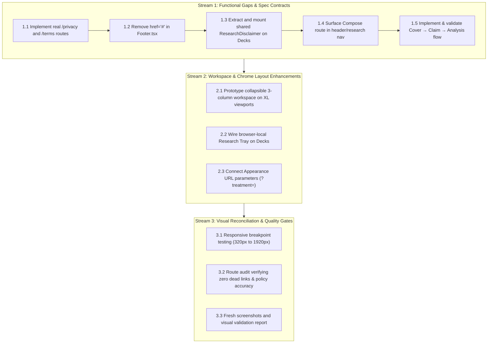

# Figma ↔ `/` (Decks) Gap Analysis & Decision Framework

> **Review status:** Revised per follow-up review on Issue #9 (`IC_kwDOOLDB-s8AAAABakCqvw`).  
> **Framing:** Figma frames (`qmVMnfR9DpQFyYtaiSizYD`) provide an **aspirational design direction** and a catalog of candidate requirements. They do **not** constitute an unconditional implementation mandate over the running product, `SPEC.md`, canonical data model, or established system capabilities. Visual difference alone is not treated as a defect.

---

## 1. Traceability & Figma References

The node IDs originally cited in `SPEC.md` for card discovery (`7:4518`, `7:4528`, `7:4558`, `7:4571`) are obsolete in Figma file `qmVMnfR9DpQFyYtaiSizYD`. The active design frames are:

| Node ID | Frame Name | Purpose / Surface |
|---|---|---|
| `7:4434` | Deck / Shuffle (base) | Three-column workspace layout with flip card |
| `12:1446` | Deck / Shuffle — Atmospheric | Dark/tinted atmospheric presentation treatment |
| `12:1644` | Deck / Shuffle — Editorial | High-contrast editorial presentation treatment |
| `12:1841` | Deck / Shuffle — Workspace | Dense, tool-oriented workspace treatment |
| `7:4617` | Card Detail — Front / Back | Extended two-sided card detail and inquiry decomposition |

---

## 2. Classification Schema

Every divergence identified between Figma and the running product is categorized under one of five dispositions:

1. **Required product behaviour** — Supported by `SPEC.md`, `ROADMAP.md`, established decisions, or an unambiguous user need.
2. **Candidate design enhancement** — Present in Figma, but requires an explicit product/architectural decision before implementation.
3. **Existing implementation capability** — Already implemented in another subsystem (e.g. Graph or Research); must be reconciled and reused rather than reinvented.
4. **Design/implementation gap** — Behaviour is underspecified in both Figma and the code; requires design completion or product definition.
5. **Out of scope / deferred** — Requires backend models, persistence contracts, auth integration, or legal/content assets not currently scheduled.

---

## 3. Currently Aligned Capabilities

The running Decks surface (`src/pages/Deck.tsx`, `src/deck/*`) already implements core discovery capabilities verified against recent commits:

- **Scope strip**: Card count, axis filter, status filter, and `Without repeats` toggle (`deck-scope.tsx`) align with Figma `8 CARDS` / `All axes ▾` / `Open questions` / `Without repeats`.
- **Card identity & status badge**: `Card / ID-01` paired with `OPEN · UNVERIFIED` (`card-metadata.tsx`, `status-badge.tsx`, commit `57417ca`) matches agreed status presentation (with other statuses like `CONTEXT-DEPENDENT` rendering their own human-readable labels).
- **Taxonomy chips**: Axis, mechanism, and concept chips (`classification-tags.tsx`).
- **Provenance & reasoning preview**: Collapsed technical details with reader-facing summary leads (`provenance-preview.tsx`, commits `7ecb232`, `73a5e6d`).
- **Evidence summary & navigation controls**: Evidence counter and `Previous / position / Shuffle next` controls (`card-navigation.tsx`).
- **XL Desktop measure**: Responsive widening up to `xl:max-w-5xl` while retaining prose readability (`5f42e97`).

---

## 4. Gap Analysis & Decision Matrix

### 4.1. Footer, Privacy, Terms, and Resources Routes
- **Classification:** **1. Required product behaviour**
- **User problem:** Readers and institutional users clicking "Privacy", "Terms", or "Resources" in the footer encounter inert `href="#"` links, creating false compliance and a broken navigation experience.
- **Evidence / Authority:** `src/components/Footer.tsx` lines 22–40 render `href="#"`. The router (`src/App.tsx`) has no destinations for policy or resource pages.
- **Dependency:** Routing in `src/App.tsx`; audit of deployed services, server logging, Better Auth mechanics, and client storage to establish factual data flows.
- **Proposed disposition:** Resolve immediately as a concrete functional gap. Create dedicated routes/pages (`/privacy`, `/terms`) describing audited data flows: browser-local research sessions in `localStorage`, account authentication and drafts via Better Auth, server request logging, and any deployed third-party dependencies (avoiding unsubstantiated statements like "lack of trackers" until verified by audit). Link "Resources" to `/sources` or `/about` (or remove until dedicated materials exist). Eliminate all placeholder `href="#"` anchors.
- **Acceptance test:** Clicking Privacy and Terms resolves to valid routes; policy copy accurately documents audited data flows (authentication, server logging, and local storage); acceptance testing validates content accuracy against deployed architecture, not merely HTTP 200 status; no `href="#"` anchors remain in `Footer.tsx`.

---

### 4.2. Research Disclaimer Consistency
- **Classification:** **1. Required product behaviour**
- **User problem:** Readers encountering sensitive, unverified antisemitic claims on Decks do not receive the explicit epistemic context and research disclaimer visible on the Sources and Research surfaces.
- **Evidence / Authority:** Sources (`src/pages/Sources.tsx`) and Research (`src/pages/Research.tsx`) both render `<ResearchDisclaimer />` via `GraphShell.tsx`: *"Illustrative research collection. Claims, source leads, and inferences are unverified; no historical conclusions are established."* Decks currently omits this disclaimer.
- **Dependency:** Shared disclaimer component decoupled from `GraphShell` so it can be mounted cleanly in `Deck.tsx`.
- **Proposed disposition:** Extract a shared `ResearchDisclaimer` component (`src/components/ResearchDisclaimer.tsx`) and mount it at the top of the Decks page directly below the context header, ensuring identical wording across all research surfaces.
- **Acceptance test:** Decks renders the identical disclaimer copy as Sources and Research; disclaimer is responsive and keyboard-navigable.

---

### 4.3. Header Navigation & Compose Reachability
- **Classification:** **1. Required product behaviour / 3. Existing implementation capability**
- **User problem:** Users cannot discover or navigate to the Compose surface (`/research/compose`) from top-level navigation, leaving an authored capability orphaned.
- **Evidence / Authority:** Compose is fully implemented in `src/pages/Compose.tsx` and routed in `src/App.tsx`, and Figma includes Compose in its navigation hierarchy. `src/components/Header.tsx` only lists Decks, Explorer, Graph, Research, and Sources.
- **Dependency:** Information Architecture (IA) decision on whether Compose belongs in global navigation or as a primary sub-action on the Research surface.
- **Proposed disposition:** Decide canonical IA. Either add Compose to `NAV_ENTRIES` in `src/components/Header.tsx` or provide a persistent, prominent sub-navigation entry point on `/research`. Ensure all top-level destinations are reachable without dead ends.
- **Acceptance test:** `/research/compose` is reachable in at most one click from the global header or Research landing page; active navigation highlighting correctly indicates active section.

---

### 4.4. "In your research tray" Session Sidebar
- **Classification:** **3. Existing implementation capability**
- **User problem:** While shuffling and discovering cards on Decks, users want to retain candidate cards for temporary inquiry without losing their place or navigating away.
- **Evidence / Authority:** Figma node `7:4434` displays a right-hand rail: `In your research tray (3)` and `Before you connect`. The Research Workspace implements browser-local working state via `useResearchSession` (`src/research/research-session.ts`, `RESEARCH_SESSION_STORAGE_KEY`).
- **Dependency:** Reusing `useResearchSession` and `ResearchEntry` without duplicating state logic or conflating with account-level actions.
- **Proposed disposition:** Connect the existing browser-local research session (`truth-cards/research-session` in `localStorage`) to Decks as a scratchpad tray. Maintain a strict semantic boundary between adding to the temporary **Research Tray** (browser-local working selection) and the account-bound **Save card** action (`POST /api/cards/:id/save`, ROADMAP §150–166). The UI must explicitly disclose the tray as unauthenticated, browser-local working memory so users do not mistake tray items for account-saved cards.
- **Acceptance test:** Adding a card to the Research Tray writes exclusively to local `useResearchSession` without triggering account save mutations; opening `/research` displays the same tray items; tray UI clearly discloses local-only persistence; independent "Save card" action retains separate account-bound semantics.

---

### 4.5. Appearance Selector (Atmospheric / Editorial / Workspace)
- **Classification:** **3. Existing implementation capability / 2. Candidate design enhancement**
- **User problem:** Researchers examining claims in different environments (reading prose vs. analytical inspection) benefit from tailored contrast and visual density.
- **Evidence / Authority:** Implemented in the Graph subsystem (`src/graph/appearance.ts`, supporting `atmospheric`, `editorial`, `workspace`). Figma frames `12:1446`, `12:1644`, and `12:1841` demonstrate these modes on Decks.
- **Dependency:** Clarifying whether Appearance on Decks represents visual theme tokens (like in Graph) or alternate page layouts/densities, and separating it from global light/dark mode (`ThemeProvider`).
- **Proposed disposition:** Define Appearance strictly as a visual presentation treatment (CSS token set) rather than an architectural page restructure. Distinguish it clearly from the global light/dark theme toggle. Reuse token definitions from `src/graph/appearance.ts`. Resolve persistence explicitly: use a URL query parameter (`?treatment=atmospheric|editorial|workspace`) as the canonical persistence mechanism so views remain shareable, reproducible, and aligned with Graph projection URLs; optionally fall back to `localStorage` only as a default when no parameter is present. Do not introduce account-level persistence until an account preferences model is formally defined.
- **Acceptance test:** Selecting Atmospheric, Editorial, or Workspace updates CSS tokens and URL parameter `?treatment=` without resetting light/dark theme; sharing the URL reproduces the selected treatment; layout structure remains stable across modes.

---

### 4.6. Three-Stage Card Model: Cover → Claim → Analysis
- **Classification:** **1. Required product behaviour** (Approved in canonical edit of [comment #6077590207](https://github.com/ubuntupunk/as-truth-cards/issues/9#issuecomment-6077590207) and codified in `SPEC.md` §1, §6.2, §7, §10, and §15).
- **User problem:** Readers need clear visual recognition anchors to browse cards, but complex analytical arguments and provenance evidence overflow fixed physical card dimensions and hinder accessibility if forced into a literal 3D flip.
- **Evidence / Authority:** Canonical decision in `SPEC.md` §7 and issue comment #6077590207 replaces the physical 3D flip metaphor with three distinct presentation stages for one canonical card:
  1. **Cover (Recognition/Discovery):** Displays card image (where rights-cleared, reviewed, and described) with title, optional compact ID, and explicit `Examine card` action. Neutral/typographic fallback when imagery is absent, unreviewed, or fails to load.
  2. **Claim Face (What is Asserted):** Revealed by `Examine card`. Displays core question/assertion formulation, canonical classification, human-readable epistemic status (`OPEN · UNVERIFIED` or other human-readable label), research framing, and explicit `Read analysis` action.
  3. **Analysis Face (How it is Examined):** Revealed by `Read analysis`. Displays detailed analysis, distinct sources and evidence items with provenance context, reasoning chains, and known counterevidence/limitations. Clear return-to-Claim and close/back-to-discovery actions.
- **Dependency:** Component architecture refactor (`src/deck/featured-card.tsx`, `card-discovery.tsx`, `card-reading.tsx`); image asset and fallback presentation; keyboard/screen-reader focus management.
- **Proposed disposition:** Implement the three-stage `Cover → Claim → Analysis` flow directly:
  - Closing returns to the same deck position, preserving active filters and card identity.
  - Mobile may open directly to the Claim face if Cover remains available as the discovery representation.
  - Image may persist as a small visual anchor on Claim/Analysis faces without competing with long-form prose.
  - No 3D transform or hover animations required; respects `prefers-reduced-motion`; scroll-safe on mobile.
- **Acceptance test:** Cover presents title, optional image with alt text (or typographic fallback), and `Examine card`; `Examine card` transitions to Claim face; `Read analysis` transitions to Analysis face; return/close actions preserve deck position, filters, and card identity; fully operable by keyboard and screen readers with zero content clipping on narrow viewports.

---

### 4.7. Three-Column Workspace Layout (Deck Nav Rail + Discovery + Session Sidebar)
- **Classification:** **2. Candidate design enhancement**
- **User problem:** High-density desktop users have ample horizontal space and could browse categories and view tray items alongside the featured card.
- **Evidence / Authority:** Figma frame `7:4434` specifies a 1440px canvas divided into: Left rail (232px) + Card discovery (792px) + Session sidebar (320px). `SPEC.md` §3.3 specifies a centered single-column composition (`max-w-4xl xl:max-w-5xl`).
- **Dependency:** Responsive breakpoint strategy; deciding if the navigation rails provide sufficient utility on Decks to justify layout complexity.
- **Proposed disposition:** Evaluate the responsive cost. The three-column layout should only activate on wide desktop viewports (`>= 1280px` or `>= 1440px`). On mobile and tablet (`< 1280px`), rails must collapse into accessible slide-out sheets or bottom navigation, ensuring the primary card maintains its optimal reading measure (65–75ch) without crowding.
- **Acceptance test:** At 1440px, three columns render cleanly without clipping; at 768px and 375px, rails collapse into accessible drawers or tabs; no horizontal viewport scroll occurs at any breakpoint.

---

### 4.8. Deck Navigation Rail ("Your decks", "New deck", Categories)
- **Classification:** **5. Out of scope / deferred (User CRUD) & 2. Candidate enhancement (Category browsing)**
- **User problem:** Users may want to organize cards into custom sets or explore cards grouped by specific ontological categories.
- **Evidence / Authority:** Figma left rail lists `Your decks` (4 items + `New deck`) and `Browse categories` (Axis, Mechanism, Concept, Locale, Collection). The database and API currently have no data model, CRUD endpoints, or persistence schema for user-created decks.
- **Dependency:** Data model and schema migration for user collections; Better Auth authorization if user-owned.
- **Proposed disposition:** 
  - Classify user-owned "New deck" and custom deck CRUD as **Out of scope / deferred** until a durable persistence contract is defined.
  - Treat `Browse categories` as a candidate enhancement: map category links directly to existing graph query filters and facets (e.g. `?axis=`, `?mechanism=`, `?concept=`) which the backend already supports.
- **Acceptance test:** No non-functional "New deck" or placeholder CRUD buttons are rendered; category links filter the deck using existing query parameters.

---

### 4.9. Generic Image Fallback & Cover Imagery Guardrails
- **Classification:** **1. Required product behaviour** (Codified in `SPEC.md` §7.1 and §7.5).
- **User problem:** Visual imagery anchors memory and recognition during discovery, but unverified, generic, or rights-violating images can mislead readers or distort historical facts.
- **Evidence / Authority:** Canonical decision in `SPEC.md` §7.1, §7.5 and issue comment #6077590207 sets strict guardrails for Cover imagery:
  1. Recognition/illustration imagery on the Cover is not a Source or Evidence item and must never be silently promoted to evidence.
  2. All Cover images must have source/rights/attribution tracking and descriptive alternative text.
  3. Never present generated, generic, reconstructed, or illustrative imagery as authentic historical/documentary proof.
  4. Images are strictly optional. When an asset is absent, unreviewed, or fails to load, a deliberate neutral/typographic fallback must render without affecting canonical identity, classification, or epistemic status.
- **Dependency:** Image metadata fields in card presentation models; fallback component styling; accessible `alt` text pipeline.
- **Proposed disposition:** Implement the image-led Cover with deliberate typographic fallback:
  - If a rights-cleared, reviewed image exists, render it with meaningful alt text.
  - If no image is available, render the neutral typographic cover layout with zero layout shifts.
  - Maintain the image as an optional small visual anchor on Claim/Analysis faces if desired, ensuring it never competes with analytical prose.
- **Acceptance test:** Valid images render with alt text; broken or missing image links render the typographic fallback cleanly; no image is misrepresented as an evidentiary source.

---

### 4.10. Brand, Headings, Prompt Copy, and Context Bar
- **Classification:** **4. Design/implementation gap**
- **User problem:** Discrepancies between Figma headings ("Discover / 01", "Try a different lens") and code headings ("Decks", "Look again through another lens") create ambiguity in editorial voice.
- **Evidence / Authority:** Figma displays brand `TROPE DECK` and single prompt `Try a different lens`. Codebase uses canonical brand `Trope Cards` and a richer 4-lens discovery prompt derived from card `coreQuestion`.
- **Dependency:** Product brand decision and editorial content standards.
- **Proposed disposition:** Retain canonical product name `Trope Cards` unless an explicit brand change is mandated. Reconcile the context bar to `Trope Cards · Research · Decks`. Preserve the implemented multi-lens discovery prompt (`Look again through another lens`), as it is deeply grounded in card ontology data.
- **Acceptance test:** Product title consistently reads `Trope Cards`; context bar clearly displays surface hierarchy; lens cards render working investigative questions.

---

### 4.11. Workspace Status Bar vs. Global Footer
- **Classification:** **4. Design/implementation gap**
- **User problem:** Merging workspace diagnostic info (sync status, item counts) with global legal links in the same bar confuses navigational hierarchy.
- **Evidence / Authority:** Figma includes a workspace status bar at the bottom of the canvas. The application currently renders `Footer.tsx` (copyright, educational notice, policy links).
- **Dependency:** Defining clear semantic boundaries between workspace chrome and site-wide footer.
- **Proposed disposition:** Maintain separation of concerns:
  - `Footer.tsx` remains the global site footer at the bottom of the page, containing copyright, educational notices, and legal links.
  - A workspace status bar (analogous to `GraphStatusStrip`) lives inside the workspace container above the footer, reporting live session state (e.g. cards loaded, filter status) without duplicating navigation or legal text.
- **Acceptance test:** Decks page clearly separates workspace status indicators from the global page footer; no duplicate links or conflicting layout regions.

---

## 5. Phased Implementation Roadmap

Implementation is divided into three distinct execution streams:

### Stream 1: Concrete Functional Gaps & Spec Contracts (Ready for Implementation)
- **1.1 Privacy & Terms routes:** Add `/privacy` and `/terms` pages in `src/pages/` and register in `src/App.tsx`. Populate with audited descriptions of `localStorage` research sessions, Better Auth mechanics, and server logging (acceptance tests validate content accuracy against deployed architecture, not merely HTTP 200).
- **1.2 Footer link cleanup:** Update `src/components/Footer.tsx` to point to real routes; link Resources to `/sources` or remove until content exists.
- **1.3 Shared research disclaimer:** Export `<ResearchDisclaimer />` as a shared component and add to `src/pages/Deck.tsx` to ensure uniform legal/epistemic disclaimers across all research surfaces.
- **1.4 Canonical IA for Compose:** Ensure `/research/compose` is directly reachable from global navigation or the Research hub.
- **1.5 Three-stage card model (Cover → Claim → Analysis):** Implement and validate the approved `Cover → Claim → Analysis` presentation lifecycle per `SPEC.md` §7, featuring optional rights-cleared imagery, deliberate typographic fallback, and explicit `Examine card` and `Read analysis` transitions with focus and state invariance.

### Stream 2: Deck Workspace & Layout Enhancements (Requires Product Approval)
- **2.1 Three-column responsive workspace:** Prototype collapsible layout that collapses rails to drawers below 1280px to protect reading measure.
- **2.2 Local research tray integration:** Connect `useResearchSession` on Decks with explicit browser-local disclosure, keeping it strictly distinct from account-bound saving (`Save card`).
- **2.3 Appearance switcher:** Apply `src/graph/appearance.ts` tokens to Decks via canonical URL query parameter `?treatment=atmospheric|editorial|workspace` for reproducible, shareable states.

### Stream 3: Visual Reconciliation & Quality Gates (Post-Approval)
- **3.1 Responsive audit:** Verify mobile (320px–375px), tablet (768px–1024px), and desktop (1280px–1920px).
- **3.2 Navigation route audit:** Automated/manual verification that every visible header and footer link resolves to a valid destination and privacy policy accurately reflects audited architecture.
- **3.3 Screenshot report:** Capture updated Decks renderings across breakpoints for issue verification.
