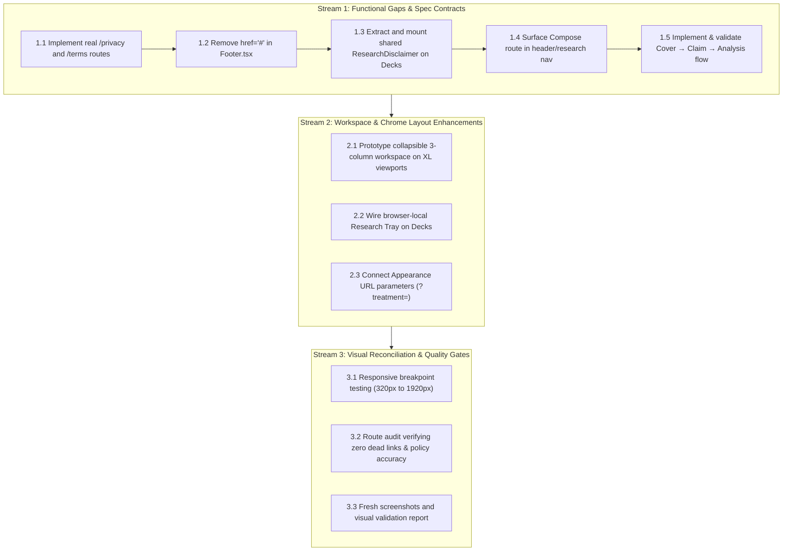

# Figma ↔ `/` (Decks) Gap Analysis & Decision Framework

> **Review status:** Revised per follow-up review on Issue #9 (`IC_kwDOOLDB-s8AAAABakCqvw`).  
> **Framing:** Figma frames (`qmVMnfR9DpQFyYtaiSizYD`) provide an **aspirational design direction** and a catalog of candidate requirements. They do **not** constitute an unconditional implementation mandate over the running product, `SPEC.md`, canonical data model, or established system capabilities. Visual difference alone is not treated as a defect.

---

## 1. Traceability & Figma References

> **Reconciliation (2026-10-12):** the live Figma file `qmVMnfR9DpQFyYtaiSizYD` (Trope Deck UI, version `2408252283547478624`, last touched 2026-10-09) was opened and inspected node-by-node (accessed as owner with view links). **The card discovery node IDs cited in `SPEC.md` (`7:4518`, `7:4528`, `7:4558`, `7:4571`) are NOT obsolete.** `7:4518` "Card discovery" is a live component instance embedded in the current Deck frame: `7:4434` → `7:4477` "Discovery workspace" → `7:4518`. The earlier claim of obsoleteness in this report was wrong; what the design actually superseded was the *interpretation* of those nodes — a fixed 2:3 physical card with a mandatory 700ms 3D flip — not the frame itself. Evidence renders saved under `docs/issue-9/screenshots/figma/`.

| Node ID | Frame Name | Purpose / Surface | Reconciliation result |
|---|---|---|---|
| `7:4434` | Deck / Shuffle (base) | Three-column workspace layout with flip card | Current canonical Deck frame (1440×1049) |
| `7:4518` | Card discovery | Workspace component: Shuffle controls / Featured card / Shuffle navigation / Discovery prompt | **Live** instance embedded in `7:4434`; not obsolete |
| `7:4528` | Featured card | The card itself (792×382, cornerRadius 10): Card metadata → Claim content → Classification tags → Divider → Research preview → Card actions | Primary action is labelled **`Read front & back`** |
| `7:4558`, `7:4571` | Shuffle navigation / Discovery prompt | Deck browse controls | Present in the live `7:4518` instance |
| `12:1446` | Deck / Shuffle — Atmospheric | Dark/tinted atmospheric presentation treatment | Appearance selector target |
| `12:1644` | Deck / Shuffle — Editorial | High-contrast editorial presentation treatment | Appearance selector target |
| `12:1841` | Deck / Shuffle — Workspace | Dense, tool-oriented workspace treatment | Appearance selector target |
| `7:4617` | Card Detail — Front / Back | Paired `Card front` (514×422) and `Card back` (514×422) faces | Two-faced card model; belongs to the Card Detail surface (Phase A), not deck discovery |

### 1.1 Reconciliation findings for the deck featured card

- **The discovery card is an editorial two-sided object.** `7:4528` "Featured card" renders: `Card metadata` (`OPEN · UNVERIFIED` badge) → `Claim content` (title + description) → `Classification tags` (three dimension-prefixed badges) → divider → `Research preview` (`Provenance & reasoning`: *"2 claims · 2 source leads · 1 draft inference"* · `Evidence`: *"0 verified items"*) → `Card actions` with exactly two controls: **`Read front & back`** (arrow-right icon) and **`Save card`** (bookmark icon).
- **The current design's primary affordance is literally the flip.** No `Examine card` label exists anywhere in the file. The concrete code/design diff to close is the cover's primary action label and semantics, not the visual chrome around it.
- **`7:4617` models the front/back relationship directly** as two paired faces of the same card: `Card front` (`Front / working claim` + `ID-01` + status badge) and `Card back` (`Back / inquiry & limits` + `ID-01` + Ask / Test / Limit prompts + `NO VERIFIED EVIDENCE ATTACHED`). Same canvas, same card, two labelled faces — the "clear front/back visual relationship" the design intends. That frame belongs to Card Detail (ROADMAP Phase A); the deck discovery card adopts the *same model* on its own scale: front = Cover, back = the reading faces.
- **No decorative cover image layer exists in the discovery card.** The card's recognition is editorial (typography + classification + folio), which supports the decision to make the no-image fallback a *designed graphic*, not a placeholder.

---

## 2. Classification Schema

Every divergence identified between Figma and the running product is categorized under one of five dispositions:

1. **Required product behaviour** — Supported by `SPEC.md`, `ROADMAP.md`, established decisions, or an unambiguous user need.
2. **Candidate design enhancement** — Present in Figma, but requires an explicit product/architectural decision before implementation.
3. **Existing implementation capability** — Already implemented in another subsystem (e.g. Graph or Research); must be reconciled and reused rather than reinvented.
4. **Design/implementation gap** — Behaviour is underspecified in both Figma and the code; requires design completion or product definition.
5. **Out of scope / deferred** — Requires backend models, persistence contracts, auth integration, or legal/content assets not currently scheduled.

---

## 3. Currently Aligned Capabilities

The running Decks surface (`src/pages/Deck.tsx`, `src/deck/*`) already implements core discovery capabilities verified against recent commits:

- **Scope strip**: Card count, axis filter, status filter, and `Without repeats` toggle (`deck-scope.tsx`) align with Figma `8 CARDS` / `All axes ▾` / `Open questions` / `Without repeats`.
- **Card identity & status badge**: `Card / ID-01` paired with `OPEN · UNVERIFIED` (`card-metadata.tsx`, `status-badge.tsx`, commit `57417ca`) matches agreed status presentation (with other statuses like `CONTEXT-DEPENDENT` rendering their own human-readable labels).
- **Taxonomy chips**: Axis, mechanism, and concept chips (`classification-tags.tsx`).
- **Provenance & reasoning preview**: Collapsed technical details with reader-facing summary leads (`provenance-preview.tsx`, commits `7ecb232`, `73a5e6d`).
- **Evidence summary & navigation controls**: Evidence counter and `Previous / position / Shuffle next` controls (`card-navigation.tsx`).
- **XL Desktop measure**: Responsive widening up to `xl:max-w-5xl` while retaining prose readability (`5f42e97`).

---

## 4. Gap Analysis & Decision Matrix

### 4.1. Footer, Privacy, Terms, and Resources Routes
- **Classification:** **1. Required product behaviour**
- **Status:** ✅ **Completed** — `/privacy` and `/terms` pages added and routed; `Footer.tsx` links to real routes with no `href="#"` anchors (Stream 1.1–1.2).
- **User problem:** Readers and institutional users clicking "Privacy", "Terms", or "Resources" in the footer encounter inert `href="#"` links, creating false compliance and a broken navigation experience.
- **Evidence / Authority:** `src/components/Footer.tsx` lines 22–40 render `href="#"`. The router (`src/App.tsx`) has no destinations for policy or resource pages.
- **Dependency:** Routing in `src/App.tsx`; audit of deployed services, server logging, Better Auth mechanics, and client storage to establish factual data flows.
- **Proposed disposition:** Resolve immediately as a concrete functional gap. Create dedicated routes/pages (`/privacy`, `/terms`) describing audited data flows: browser-local research sessions in `localStorage`, account authentication and drafts via Better Auth, server request logging, and any deployed third-party dependencies (avoiding unsubstantiated statements like "lack of trackers" until verified by audit). Link "Resources" to `/sources` or `/about` (or remove until dedicated materials exist). Eliminate all placeholder `href="#"` anchors.
- **Acceptance test:** Clicking Privacy and Terms resolves to valid routes; policy copy accurately documents audited data flows (authentication, server logging, and local storage); acceptance testing validates content accuracy against deployed architecture, not merely HTTP 200 status; no `href="#"` anchors remain in `Footer.tsx`.

---

### 4.2. Research Disclaimer Consistency
- **Classification:** **1. Required product behaviour**
- **Status:** ✅ **Completed** — shared `ResearchDisclaimer` extracted and mounted on Decks with identical copy to Sources/Research (Stream 1.3).
- **User problem:** Readers encountering sensitive, unverified antisemitic claims on Decks do not receive the explicit epistemic context and research disclaimer visible on the Sources and Research surfaces.
- **Evidence / Authority:** Sources (`src/pages/Sources.tsx`) and Research (`src/pages/Research.tsx`) both render `<ResearchDisclaimer />` via `GraphShell.tsx`: *"Illustrative research collection. Claims, source leads, and inferences are unverified; no historical conclusions are established."* Decks currently omits this disclaimer.
- **Dependency:** Shared disclaimer component decoupled from `GraphShell` so it can be mounted cleanly in `Deck.tsx`.
- **Proposed disposition:** Extract a shared `ResearchDisclaimer` component (`src/components/ResearchDisclaimer.tsx`) and mount it at the top of the Decks page directly below the context header, ensuring identical wording across all research surfaces.
- **Acceptance test:** Decks renders the identical disclaimer copy as Sources and Research; disclaimer is responsive and keyboard-navigable.

---

### 4.3. Header Navigation & Compose Reachability
- **Classification:** **1. Required product behaviour / 3. Existing implementation capability**
- **Status:** ✅ **Completed** — `Compose` added to global navigation (`NAV_ENTRIES`) with exact-match active highlighting (Stream 1.4).
- **User problem:** Users cannot discover or navigate to the Compose surface (`/research/compose`) from top-level navigation, leaving an authored capability orphaned.
- **Evidence / Authority:** Compose is fully implemented in `src/pages/Compose.tsx` and routed in `src/App.tsx`, and Figma includes Compose in its navigation hierarchy. `src/components/Header.tsx` only lists Decks, Explorer, Graph, Research, and Sources.
- **Dependency:** Information Architecture (IA) decision on whether Compose belongs in global navigation or as a primary sub-action on the Research surface.
- **Proposed disposition:** Decide canonical IA. Either add Compose to `NAV_ENTRIES` in `src/components/Header.tsx` or provide a persistent, prominent sub-navigation entry point on `/research`. Ensure all top-level destinations are reachable without dead ends.
- **Acceptance test:** `/research/compose` is reachable in at most one click from the global header or Research landing page; active navigation highlighting correctly indicates active section.

---

### 4.4. "In your research tray" Session Sidebar
- **Classification:** **3. Existing implementation capability**
- **Status:** ✅ **Completed** — the browser-local session sidebar is implemented as `src/deck/research-tray.tsx` (`ResearchTray`): count badge, card-scoped Add (disabled when the card is already in the tray), Open→`/research?focus=…` handoff, per-entry Remove, Clear, and an explicit disclosure that items live only in this browser and are never sent to an account; `Save card` retains its separate account-bound semantics (Stream 2).
- **User problem:** While shuffling and discovering cards on Decks, users want to retain candidate cards for temporary inquiry without losing their place or navigating away.
- **Evidence / Authority:** Figma node `7:4434` displays a right-hand rail: `In your research tray (3)` and `Before you connect`. The Research Workspace implements browser-local working state via `useResearchSession` (`src/research/research-session.ts`, `RESEARCH_SESSION_STORAGE_KEY`).
- **Dependency:** Reusing `useResearchSession` and `ResearchEntry` without duplicating state logic or conflating with account-level actions.
- **Proposed disposition:** Connect the existing browser-local research session (`truth-cards/research-session` in `localStorage`) to Decks as a scratchpad tray. Maintain a strict semantic boundary between adding to the temporary **Research Tray** (browser-local working selection) and the account-bound **Save card** action (`POST /api/cards/:id/save`, ROADMAP §150–166). The UI must explicitly disclose the tray as unauthenticated, browser-local working memory so users do not mistake tray items for account-saved cards.
- **Acceptance test:** Adding a card to the Research Tray writes exclusively to local `useResearchSession` without triggering account save mutations; opening `/research` displays the same tray items; tray UI clearly discloses local-only persistence; independent "Save card" action retains separate account-bound semantics.

---

### 4.5. Appearance Selector (Atmospheric / Editorial / Workspace)
- **Classification:** **3. Existing implementation capability / 2. Candidate design enhancement**
- **Status:** ✅ **Completed** — the deck mounts the graph appearance system with URL-then-storage precedence: `?treatment=atmospheric|editorial|workspace` is canonical and shareable, `localStorage` (`trope-cards:graph-treatment`) is only the default, and changing it never touches the global light/dark theme. `graphTreatmentVars` (extracted into `src/graph/appearance.ts`) is now the single source of token→`--graph-*` mapping shared by `GraphShell` and `Deck.tsx`; the selector is `src/deck/deck-appearance-control.tsx` (Stream 2).
- **User problem:** Researchers examining claims in different environments (reading prose vs. analytical inspection) benefit from tailored contrast and visual density.
- **Evidence / Authority:** Implemented in the Graph subsystem (`src/graph/appearance.ts`, supporting `atmospheric`, `editorial`, `workspace`). Figma frames `12:1446`, `12:1644`, and `12:1841` demonstrate these modes on Decks.
- **Dependency:** Clarifying whether Appearance on Decks represents visual theme tokens (like in Graph) or alternate page layouts/densities, and separating it from global light/dark mode (`ThemeProvider`).
- **Proposed disposition:** Define Appearance strictly as a visual presentation treatment (CSS token set) rather than an architectural page restructure. Distinguish it clearly from the global light/dark theme toggle. Reuse token definitions from `src/graph/appearance.ts`. Resolve persistence explicitly: use a URL query parameter (`?treatment=atmospheric|editorial|workspace`) as the canonical persistence mechanism so views remain shareable, reproducible, and aligned with Graph projection URLs; optionally fall back to `localStorage` only as a default when no parameter is present. Do not introduce account-level persistence until an account preferences model is formally defined.
- **Acceptance test:** Selecting Atmospheric, Editorial, or Workspace updates CSS tokens and URL parameter `?treatment=` without resetting light/dark theme; sharing the URL reproduces the selected treatment; layout structure remains stable across modes.

---

### 4.6. Two-Faced Card Model: Front (Cover) ↔ Back (Claim → Analysis)
- **Classification:** **1. Required product behaviour** (Approved in canonical edit of [comment #6077590207](https://github.com/ubuntupunk/as-truth-cards/issues/9#issuecomment-6077590207), reconciled with the live Figma file, and now codified in `SPEC.md` §1, §6.2, §7, §10, and §15). **Revised 2026-10-12 per the third follow-up:** the card's back is reachable through a visible flip affordance.
- **Status:** ✅ **Completed** — the card is implemented in `src/deck/featured-card.tsx` as one two-faced object: the **front** renders the Cover (a designed discovery face), the **back** carries the reading faces `Claim` then `Analysis` (stage machine unchanged in `src/deck/card-stage.ts`, owned by `src/pages/Deck.tsx`). The flip is presentation-only: `data-flipped` on the flip stage swaps faces, the inactive face is `inert`, and reduced-motion / non-3D contexts swap statefully without a transform (Stream 1.5 + flip follow-up).
- **User problem:** Readers need clear visual recognition anchors to browse cards, and must be able to discover that the card has a reverse side — without guessing that some other control opens it, and without a heavyweight literal 3D animation.
- **Evidence / Authority:** Reconciled Figma facts (see §1.1):
  - The design's card action is literally **`Read front & back`** (`7:4528`) — the flip affordance.
  - `7:4617` "Card Detail — Front / Back" renders two labelled faces of one card (`Front / working claim`, `Back / inquiry & limits`).
  - The old SPEC sentence ("a physical 3D flip is never required") contradicted the design; it is replaced (see §4.6 disposition).
- **Dependency:** Component architecture refactor (`src/deck/featured-card.tsx`, `card-actions.tsx`); image asset and designed fallback presentation; keyboard/screen-reader focus management; `prefers-reduced-motion` handling.
- **Proposed disposition:** Implement the two-faced card directly:
  - **Front = Cover:** a recognisable card visual — a rights-cleared image when one exists, otherwise a *designed* typographic/graphic fallback (folio, grid motif, eyebrow) — never an empty dashed placeholder. The front's primary control is the flip affordance **`Read front & back`**.
  - **Back = reading faces:** the existing `Claim → Analysis` stages, unchanged in semantics. The back always carries a **`Back to front`** control (the reverse flip).
  - The flip is presentation-only; it never changes the card's identity, classification, or epistemic status. Claim/Analysis separation and status/provenance semantics are untouched.
  - Closing still returns to the same deck position, preserving active filters and card identity. Mobile may open directly to a face if the Cover remains available as the discovery representation.
  - Transition/3D animation is optional; if reduced motion or 3D is unavailable, faces swap statefully with no transform (or no animation at all). Never depend on hover; scroll-safe on mobile.
- **Acceptance test:** Front presents a recognisable cover (image with alt/attribution, or designed fallback) and a visible `Read front & back` control that flips to the Claim face; the back presents `Back to front`; `Read analysis` transitions to Analysis; return/close actions preserve deck position, filters, and card identity; flip works by keyboard and for screen readers; reduced-motion and non-3D contexts render both faces correctly; zero content clipping on narrow viewports.

---

### 4.7. Three-Column Workspace Layout (Deck Nav Rail + Discovery + Session Sidebar)
- **Classification:** **2. Candidate design enhancement**
- **Status:** ✅ **Completed** — the workspace grid is implemented in `src/deck/deck-workspace.tsx` (`DeckWorkspace`): at `xl` (≥1280px) the deck is `[232px, minmax(0,1fr), 320px]` with sticky rails; below `xl` the rails collapse and are reachable only through toolbar buttons that open them as modal drawers (`role="dialog"`, accessible name, backdrop, Escape). The dialog layer also traps Tab, marks the rest of the page `inert` while open, and returns focus to the invoking control on dismissal (`src/deck/drawer-a11y.ts`; Stream 3 follow-up). The fluid middle column keeps the card's reading measure at every width, so no breakpoint forces viewport scroll (Stream 2).
- **User problem:** High-density desktop users have ample horizontal space and could browse categories and view tray items alongside the featured card.
- **Evidence / Authority:** Figma frame `7:4434` specifies a 1440px canvas divided into: Left rail (232px) + Card discovery (792px) + Session sidebar (320px). `SPEC.md` §3.3 specifies a centered single-column composition (`max-w-4xl xl:max-w-5xl`).
- **Dependency:** Responsive breakpoint strategy; deciding if the navigation rails provide sufficient utility on Decks to justify layout complexity.
- **Proposed disposition:** Evaluate the responsive cost. The three-column layout should only activate on wide desktop viewports (`>= 1280px` or `>= 1440px`). On mobile and tablet (`< 1280px`), rails must collapse into accessible slide-out sheets or bottom navigation, ensuring the primary card maintains its optimal reading measure (65–75ch) without crowding.
- **Acceptance test:** At 1440px, three columns render cleanly without clipping; at 768px and 375px, rails collapse into accessible drawers or tabs; no horizontal viewport scroll occurs at any breakpoint.

---

### 4.8. Deck Navigation Rail ("Your decks", "New deck", Categories)
- **Classification:** **5. Out of scope / deferred (User CRUD) & 2. Candidate enhancement (Category browsing)**
- **Status:** ✅ **Completed** — the rail is implemented as `src/deck/browse-rail.tsx` (`BrowseRail`). No placeholder CRUD renders. **Correction to the §4.8 proposal noted during implementation:** the deck listing API (`GET /api/graph/cards`) supports `locale`, `limit`, and `offset` only — `?axis=`, `?mechanism=`, and `?concept=` are not real deck filtering params. The rail therefore maps Axis to the deck's *existing* client-side axis scope filter (obeying the project's "never invent a filter" rule: it lists only the axes the loaded cards carry), and Mechanism / Concept / Locale / Collection — facets of the Graph Explorer, not the listing API — are surfaced as one honest pointer link to `/graph` rather than dead buttons (Stream 2).
- **User problem:** Users may want to organize cards into custom sets or explore cards grouped by specific ontological categories.
- **Evidence / Authority:** Figma left rail lists `Your decks` (4 items + `New deck`) and `Browse categories` (Axis, Mechanism, Concept, Locale, Collection). The database and API currently have no data model, CRUD endpoints, or persistence schema for user-created decks.
- **Dependency:** Data model and schema migration for user collections; Better Auth authorization if user-owned.
- **Proposed disposition:** 
  - Classify user-owned "New deck" and custom deck CRUD as **Out of scope / deferred** until a durable persistence contract is defined.
  - Treat `Browse categories` as a candidate enhancement: map category links directly to existing graph query filters and facets (e.g. `?axis=`, `?mechanism=`, `?concept=`) which the backend already supports.
- **Acceptance test:** No non-functional "New deck" or placeholder CRUD buttons are rendered; category links filter the deck using existing query parameters.

---

### 4.9. Generic Image Fallback & Cover Imagery Guardrails
- **Classification:** **1. Required product behaviour** (Codified in `SPEC.md` §7.1 and §7.5).
- **Status:** ✅ **Completed** — the Cover renders an optional, rights-cleared image with required alt text and attribution, and a **designed** typographic/graphic fallback (gradient band, grid motif, ghosted folio, eyebrow label) when imagery is absent, undescribed, or fails — the former empty dashed "Research card" placeholder was removed. Recognition imagery is never promoted to Source/Evidence (Stream 1.5 + flip follow-up).
- **User problem:** Visual imagery anchors memory and recognition during discovery, but unverified, generic, or rights-violating images can mislead readers or distort historical facts.
- **Evidence / Authority:** Canonical decision in `SPEC.md` §7.1, §7.5 and issue comment #6077590207 sets strict guardrails for Cover imagery:
  1. Recognition/illustration imagery on the Cover is not a Source or Evidence item and must never be silently promoted to evidence.
  2. All Cover images must have source/rights/attribution tracking and descriptive alternative text.
  3. Never present generated, generic, reconstructed, or illustrative imagery as authentic historical/documentary proof.
  4. Images are strictly optional. When an asset is absent, unreviewed, or fails to load, a deliberate neutral/typographic fallback must render without affecting canonical identity, classification, or epistemic status.
- **Dependency:** Image metadata fields in card presentation models; fallback component styling; accessible `alt` text pipeline.
- **Proposed disposition:** Implement the image-led Cover with deliberate typographic fallback:
  - If a rights-cleared, reviewed image exists, render it with meaningful alt text.
  - If no image is available, render the neutral typographic cover layout with zero layout shifts.
  - Maintain the image as an optional small visual anchor on Claim/Analysis faces if desired, ensuring it never competes with analytical prose.
- **Acceptance test:** Valid images render with alt text; broken or missing image links render the typographic fallback cleanly; no image is misrepresented as an evidentiary source.

---

### 4.10. Brand, Headings, Prompt Copy, and Context Bar
- **Classification:** **4. Design/implementation gap**
- **User problem:** Discrepancies between Figma headings ("Discover / 01", "Try a different lens") and code headings ("Decks", "Look again through another lens") create ambiguity in editorial voice.
- **Evidence / Authority:** Figma displays brand `TROPE DECK` and single prompt `Try a different lens`. Codebase uses canonical brand `Trope Cards` and a richer 4-lens discovery prompt derived from card `coreQuestion`.
- **Dependency:** Product brand decision and editorial content standards.
- **Proposed disposition:** Retain canonical product name `Trope Cards` unless an explicit brand change is mandated. Reconcile the context bar to `Trope Cards · Research · Decks`. Preserve the implemented multi-lens discovery prompt (`Look again through another lens`), as it is deeply grounded in card ontology data.
- **Acceptance test:** Product title consistently reads `Trope Cards`; context bar clearly displays surface hierarchy; lens cards render working investigative questions.

---

### 4.11. Workspace Status Bar vs. Global Footer
- **Classification:** **4. Design/implementation gap**
- **User problem:** Merging workspace diagnostic info (sync status, item counts) with global legal links in the same bar confuses navigational hierarchy.
- **Evidence / Authority:** Figma includes a workspace status bar at the bottom of the canvas. The application currently renders `Footer.tsx` (copyright, educational notice, policy links).
- **Dependency:** Defining clear semantic boundaries between workspace chrome and site-wide footer.
- **Proposed disposition:** Maintain separation of concerns:
  - `Footer.tsx` remains the global site footer at the bottom of the page, containing copyright, educational notices, and legal links.
  - A workspace status bar (analogous to `GraphStatusStrip`) lives inside the workspace container above the footer, reporting live session state (e.g. cards loaded, filter status) without duplicating navigation or legal text.
- **Acceptance test:** Decks page clearly separates workspace status indicators from the global page footer; no duplicate links or conflicting layout regions.

---

## 5. Phased Implementation Roadmap

Implementation is divided into three distinct execution streams:

### Stream 1: Concrete Functional Gaps & Spec Contracts ✅ Complete
- ✅ **1.1 Privacy & Terms routes:** `/privacy` and `/terms` pages added in `src/pages/` and registered in `src/App.tsx`, describing audited `localStorage` research sessions, Better Auth mechanics, and server logging.
- ✅ **1.2 Footer link cleanup:** `src/components/Footer.tsx` points to real routes; no `href="#"` anchors remain.
- ✅ **1.3 Shared research disclaimer:** `<ResearchDisclaimer />` exported as a shared component and mounted in `src/pages/Deck.tsx`, giving uniform epistemic disclaimers across research surfaces.
- ✅ **1.4 Canonical IA for Compose:** `/research/compose` is reachable from global navigation (`src/components/Header.tsx`), with exact-match active highlighting.
- ✅ **1.5 Two-faced card model (front Cover ↔ back Claim → Analysis):** implemented per `SPEC.md` §7 as one two-faced object with a designed cover fallback (no dashed placeholder), the Figma-verbatim `Read front & back` flip affordance, a `Back to front` reverse control, and `prefers-reduced-motion` / non-3D fallbacks; `Read analysis` / `Back to claim` transitions and focus/state invariance preserved.

### Stream 2: Deck Workspace & Layout Enhancements ✅ Complete
- ✅ **2.1 Three-column responsive workspace:** `src/deck/deck-workspace.tsx` renders `[232px, minmax(0,1fr), 320px]` at `xl`, collapsing the rails into accessible modal drawers (`role="dialog"`, backdrop, Escape) below 1280px to protect reading measure.
- ✅ **2.2 Local research tray integration:** `src/deck/research-tray.tsx` connects `useResearchSession` on Decks with an explicit browser-local disclosure, keeping it strictly distinct from account-bound saving (`Save card`); Open hands off to `/research?focus=…`.
- ✅ **2.3 Appearance switcher:** `graphTreatmentVars` extracted in `src/graph/appearance.ts` (shared by `GraphShell` and `Deck.tsx`); `src/deck/deck-appearance-control.tsx` + `?treatment=atmospheric|editorial|workspace` (canonical, shareable) with `localStorage` as the default only.

### Stream 3: Visual Reconciliation & Quality Gates (Post-Approval) ✅ Complete
- ✅ **3.1 Responsive audit:** The Decks page holds a `0` horizontal-overflow budget from 320px to 1920px. At `xl` (≥1280px) the three-column workspace applies (`232px · card · 320px`); below `xl` the rails collapse to toolbar buttons and the page is a single fluid column (`max-w-4xl`). The rail/tray drawers open as `role="dialog" aria-modal="true"` (Escape **and** backdrop click both close; focus moves to Close).

  | Viewport | Layout | `overflow-x` | Rails | Artifact |
  | --- | --- | --- | --- | --- |
  | 1920px | xl 3-col `232 / 680 / 320` (container `max-w-content` centered) | 0 | both visible | `screenshots/decks-1920px.png` |
  | 1440px | xl 3-col `232 / 680 / 320` | 0 | both visible | `screenshots/decks-1440px.png` |
  | 1280px | xl 3-col `232 / 636 / 320` (breakpoint activates at exactly 1280) | 0 | both visible | `screenshots/decks-1280px.png` |
  | 1024px | single column `896px`; rails hidden; toolbar shown | 0 | drawer | `screenshots/decks-1024px.png`, `decks-1024px-drawer-browse.png` |
  | 768px | single column `724px`; rails hidden; toolbar shown | 0 | drawer | `screenshots/decks-768px.png` |
  | 375px | single column; rails hidden; toolbar shown | 0 | drawer | `screenshots/decks-375px.png` |
  | 320px | single column; rails hidden; toolbar shown | 0 | drawer | `screenshots/decks-320px.png` |

  _Method note (superseded):_ the original 375px/320px figures were measured through a same-origin `<iframe>` (media queries resolve against the iframe width). That is a **CSS-viewport measurement only**, not an interaction test. See the second follow-up below for real `browsingContext.setViewport` measurements at 320/375/768/1024/1280 on a live browser.

- ✅ **3.2 Navigation route audit:** Every header/footer link resolves to a registered route in `src/App.tsx` — nav `/`, `/explore`, `/graph`, `/research`, `/research/compose`, `/sources` (+ `/admin` when authenticated); footer `/privacy`, `/terms`, `/sources`. All ten routes were loaded live and mount cleanly (non-empty `#root`, no `Cannot GET`, no error boundary; `/admin` correctly renders "Sign in required"). The privacy page's stored-data claims were checked against the audited architecture: it imports the canonical `RESEARCH_SESSION_STORAGE_KEY` from `@/research/research-session`, documents the browser-local session as never sent to servers, describes Better Auth account/session records (email, role, IP, user-agent, session cookie), and states the server runs no request-logging middleware — all accurate.
- ✅ **3.3 Screenshot report:** Fresh Decks renderings captured at 320 / 375 / 768 / 1024 (base + browse drawer) / 1280 / 1440 / 1920 in `docs/issue-9/screenshots/`.

- ⚠️ **Finding (resolved in `Header.tsx`):** the **global** `Header` previously needed ~648px and, below ~500px, clipped `Research` / `Compose` / `Sources` with no wrap/hamburger/scroll. Fixed: below `md` (768px) the primary entries move into a toggleable menu behind a hamburger (`data-testid="nav-menu-toggle"`, `aria-controls="global-nav-menu"`), Escape/route-change close it, and every primary destination is reachable at 320–375px. Tracked as `as-truth-cards-0vn` (kept open for reviewer sign-off).

### Stream 3 follow-up (reviewer-requested)
- ✅ **Drawer accessibility completed and verified:** both drawers now trap Tab (`src/deck/drawer-a11y.ts`), mark every background branch `inert` while open, expose an accessible name (`aria-label`), and return focus to the invoking toolbar button on Escape / backdrop / Close dismissal. Verified live in Firefox at 1024px (see issue report).
- ✅ **Privacy scope tightened:** `src/pages/Privacy.tsx` now names the two infrastructure providers (Render hosting, Neon database), scopes the "no logging" claim to the application itself, and states explicitly that provider-side logs are outside the application and not attested by the page.
- ⚠️ **Responsive evidence limit:** the 320/375px results are CSS-viewport measurements via a same-origin `<iframe>`; they are **not** a substitute for a full narrow-window browser interaction test. Addressed by the second follow-up below.

### Stream 3 second follow-up — real-browser keyboard & viewport verification ✅
A genuine interaction harness was built so the verification is **not** code-level and **not** iframe-emulated:
- **Browser:** Mozilla Firefox 157.0 (Gecko/20100101), headed on the real X11 display `:0`, driven over **WebDriver BiDi**.
- **Input:** **XTest** X11 events (OS-level `KeyPress`/`KeyRelease` — identical to a physical keyboard, `isTrusted`) for all keyboard steps; BiDi `input.performActions` for pointer; BiDi `script.evaluate` for assertions.
- **Viewport:** real `browsingContext.setViewport` (no iframe), so `innerWidth` 320/375/768/1024/1280 are true viewports.

- ✅ **Drawer keyboard pass (both drawers):** opening with a real `Enter` **from the focused trigger**, initial focus on Close, background `inert`, `Shift+Tab` wraps to the last control, 12× `Tab` never leaves the layer, `Escape` closes and restores focus to the trigger, backdrop click closes and restores, and `Enter` on Close closes and restores — **all pass** for **Browse categories** and **Research tray**.

  | Check | Browse | Tray |
  | --- | --- | --- |
  | Real `Enter` on trigger opens | ✅ | ✅ |
  | Initial focus on Close | ✅ | ✅ |
  | Background `inert` (header/footer/workspace) | ✅ | ✅ |
  | `Shift+Tab` wraps to last | ✅ | ✅ |
  | 12× `Tab` stays trapped | ✅ | ✅ |
  | `Escape` closes + restores focus | ✅ | ✅ |
  | Backdrop click closes + restores focus | ✅ | ✅ |
  | `Enter` on Close closes + restores focus | ✅ | ✅ |

- ✅ **Viewport reachability matrix (real viewports):** at **320 / 375** the hamburger is visible, all six primary nav links are in the opened menu with `first`/`last` link `right-edge ≤ innerWidth` (no overflow), and both drawer triggers are visible/operable. At **768 / 1024** the hamburger is hidden and the horizontal header shows all six primary links. At **1280** the toolbar triggers are `xl:hidden` **by design** — the browse (232px) and tray (320px) rails are permanently visible instead, so the affordances remain reachable.

  | Viewport | Hamburger | Primary nav | Drawer triggers |
  | --- | --- | --- | --- |
  | 320px | shown | all 6 in menu, no overflow | both visible |
  | 375px | shown | all 6 in menu, no overflow | both visible |
  | 768px | hidden | all 6 in header | both visible |
  | 1024px | hidden | all 6 in header | both visible |
  | 1280px | hidden | all 6 in header | replaced by persistent rails (`xl`) |

- **Harness note (not an app defect):** BiDi synthetic `Enter`/`Space` key actions do **not** trigger default button activation in this headless/automation path (even a plain injected `<button onclick>` fails, and `document.hasFocus()` is `false`). Real **XTest** keyboard events activate the same buttons correctly, which is why the pass above uses OS-level input. This is a property of the automation channel, not the app.

- ✅ **Privacy (unchanged):** `src/pages/Privacy.tsx` keeps provider-side (Render/Neon) logging explicitly **unverified**; no change made.
- 🔐 **CORS/security follow-up:** the open `cors()` default and trusted-proxy/IP assumptions in `server/index.ts` are tracked as a **separate** security-review issue, not folded into this product-shell acceptance.

---

## 6. Product-shell landmark acceptance matrix (sprint close-out, 2026-10-12)

> **Purpose.** Truthful close-out of the current product-shell sprint. Each landmark is scored independently on four axes the maintainer asked to keep separate:
>
> - **Route integrity** — the route mounts and renders the intended component/data.
> - **Navigation usability** — a user can find and operate the route from a real viewport.
> - **Evidence class** — `A` automated (test/assertion), `M` manually exercised in a real browser, `C` code-inspected only, `—` not performed.
> - **Object observed** — `app` (our code/behaviour) vs `provider` (hosting/DB/platform behaviour).
>
> `Implemented` ≠ `verified` ≠ `accepted`. Nothing here closes Issue #9; it records what is actually true today.

### 6.1 Legend and standing caveats

- Status vocabulary: **implemented**, **verified**, **partially implemented**, **blocked**, **deferred**.
- **Canonical vs legacy routing is now tested.** `src/app-routes.test.tsx` (commit `e30898d`) runs react-router's own matcher (`matchRoutes`, a pure function) over the exported `APP_ROUTES` table and asserts `/` → `Deck`, `/legacy/deck` → `LegacyDeck` (and not `Deck`), unknown paths → `NotFound`, every header destination resolves to a real surface, and the legacy route stays **out of** `NAV_ENTRIES`. This closes the one explicit unmet Milestone 1 criterion. The table was extracted out of `App.tsx` into `src/app-routes.tsx` so it is assertable without mounting a browser router (`App` maps it into `<Route>`s).
- **`trope-graph:check` environment caveat (see §6.3, landmark 10):** the gate still requires `TROPE_GRAPH_DATABASE_URL` to be exported (the graph scripts do not load `.env`). The former `check-drift` extension-provisioning blocker is **fixed** in `trope-cards/scripts/check-drift.mjs` (this pass); the gate no longer depends on manually provisioning `pg_trgm`/`unaccent` in `template1`.
- **Automation channel limit:** BiDi synthetic `Enter`/`Space` do not activate buttons; real XTest OS-level keys do. The keyboard pass therefore uses XTest, not BiDi key actions (`tools/bidi-firefox/`).

### 6.2 Landmark matrix

| # | Landmark | Route integrity | Navigation usability | Status | Evidence (class · object) | Remaining acceptance test |
|---|---|---|---|---|---|---|
| 1 | **Decks `/` + legacy route** | `/` → `src/pages/Deck.tsx`; `/legacy/deck` → `src/pages/LegacyDeck.tsx`, via the exported `APP_ROUTES` table (`src/app-routes.tsx`) mapped in `src/App.tsx:17-23`. Legacy uses the legacy `/api/cards` store, labelled legacy/reference. | `/` is the first `NAV_ENTRIES` destination ("Decks"); legacy is intentionally **absent** from nav. | **implemented + verified** (feature shipped; routing criterion covered by test) | A · app — `test:ui` **487/487** incl. new `app-routes.test.tsx` (8 assertions: `/`, `/legacy/deck`, catch-all, per-path uniqueness, nav↔route contract) + `featured-card.test.tsx` face/state tests; commits `9b71931`, `e30898d`. | None for M1 routing. Deck surface responsive/a11y review remains under landmark 8. |
| 2 | **Graph Explorer `/graph`** | `src/pages/Graph.tsx` → `useGraphPage` (`GET /api/graph`, `/api/graph/views`, `/api/graph/search`). Real canonical projection. | Nav entry "Graph"; reachable ≤1 click at all widths. | **implemented + backend verified**; surface acceptance outstanding | A · app — `trope-graph:check` 452/452 incl. `GET /api/graph`, `/views`, `/search` integration; server-authoritative. | Surface-level responsive/a11y review of the Explorer UI (not the API); not yet formalised in the sprint. |
| 3 | **Explore / Browse `/explore`** | `src/pages/Explore.tsx` → `useDeckCards()` + `useCardSearch()` (`GET /api/graph/search`). Real canonical. | Nav entry "Explorer"; reachable ≤1 click. | **implemented**; surface acceptance outstanding | C · app — code inspection; `GET /api/graph/search` covered by graph tests. **Figma node `7:4787` (Explore) verified present** in `qmVMnfR9DpQFyYtaiSizYD` (this pass). | Documented + tested **search/filter semantics and limits**; in/out-of-result context preservation; responsive/a11y. Coordinate the shared search contract with **Issue #8** before page-specific search hardens (ROADMAP M3). |
| 4 | **Compose / Decompose `/research/compose`** | `src/pages/Compose.tsx` → canonical projection + `GET/PUT/DELETE /api/drafts/*`. Real; writes are auth-gated (401 signed-out). | Nav entry "Compose"; reachable ≤1 click. | **partially implemented** | A · app — `drafts.test.ts` (401 signed-out, cross-user isolation ✓); `compose-editor.test.tsx` `PermissionGate`. | **Blocked by the account layer:** the "Sign in" handoff navigates to `/admin`, which renders "Sign in required" with **no sign-in form** — a dead end. Complete end-to-end composition + account gate once onboarding exists (ROADMAP M4). |
| 5 | **Research Workspace `/research`** | `src/pages/Research.tsx` → graph page + `useResearchSession()` (browser `localStorage`). Explicitly **not** account-synced. | Nav entry "Research"; reachable ≤1 click. | **partially implemented** | A · app — `research-workspace-panel.test.tsx`, `research-tray.test.tsx` assert the "separate from your account" boundary. | Full workflow acceptance; tests for persistence, URL/context, and authorization; keep research vs auth vs durable-activity distinct (ROADMAP M5). |
| 6 | **Sources `/sources`** | `src/pages/Sources.tsx` → `useSources()` (`GET /api/graph/sources`). Real canonical. | Nav entry "Sources"; reachable ≤1 click. | **implemented**; **frame missing** → M6 design gap open | C · app — code inspection; `GET /api/graph/sources` covered by graph tests. | **No dedicated Sources frame exists** in `qmVMnfR9DpQFyYtaiSizYD`. Creation was **attempted via the Figma API**: the REST API exposes **no node/frame-creation endpoint**, so the frame must be authored in-editor (Plugin API). A **build-ready frame spec** was posted as an in-file comment (`1962148829`) and recorded in **§7**. Pending: human/editor authoring → record node ID(s); then responsive/a11y + source→claim/evidence acceptance (ROADMAP M6). |
| 7 | **Account / participation integration** | Server: `server/auth.ts` (Better Auth email+password only), role enum `ANONYMOUS→…→ADMIN` on `User` with `input:false`; `UserInteraction`, `Session`, `Account`, `Verification` in `public`. | **No account UI:** no sign-in/sign-up/profile/settings/activity route, no header account affordance. `Save card` is unconditionally disabled. | **blocked** (inventory + proposal **now complete**; awaiting C1/C2/C3 decisions) | A/C · app — `auth-secret.test.ts`; `drafts.test.ts` (only authed API). Account Figma frames **identified** (improved `62:*`, 6 surfaces × 3 treatments; no Verification frame) — see proposal §F.6. | Resolve C1/C2/C3; then full lifecycle + one account-gated action (Save card). **Prerequisite:** `docs/issue-9/account-onboarding-inventory-and-proposal.md`. |
| 8 | **Responsive navigation + drawer accessibility** | Routes mounted; header collapses to hamburger below `md`. | Reachability verified at 320/375/768/1024/1280 real viewports; drawer triggers operable; ≥1280 rails replace triggers by design. | **verified (automated)**; **reviewer sign-off pending** | A(XTest) · app — `tools/bidi-firefox/` document↔drawer keyboard pass (both drawers), viewport matrix; commits `ccd30eb`, `fe747bc`, `666f1e6` (all exist). | Reviewer sign-off of the acceptance checklist; a human screen-reader pass is **not** evidenced (only automated DOM/inert assertions). Mobile-header issue `as-truth-cards-0vn` stays **open** until signed off. |
| 9 | **Privacy / security follow-ups** | `/privacy` renders audited app-side flows; provider (Render/Neon) logging explicitly labelled **unverified**. | Footer link (`FOOTER_LINKS`), reachable ≤1 click. | **partially implemented**; security **deferred → Issue #10** | M/C · app + provider — privacy copy tightened (`server/index.ts` has no request-logging middleware); provider behaviour **not** attested. | Issue #10: intentional CORS policy (default `cors()` today), trusted-proxy/IP, Better Auth cookie Secure/SameSite behind the Render proxy, and tests. **Not** folded into visual cleanup. |
| 10 | **Full repo + deployment verification** | n/a | n/a | **verified with documented caveats** | A · app (+ provider not exercised) | See §6.3. |

### 6.3 Landmark 10 — verification log (HEAD `e30898d`)

| Gate | Command | Result | Notes |
|---|---|---|---|
| Typecheck (project) | `pnpm run typecheck` | ✅ pass | `tsc --noEmit` |
| Typecheck (all projects) | `pnpm run typecheck:all` | ❌ fail | **Pre-existing baseline** — `src/components/ui/{resizable,sheet,sidebar,skeleton,sonner}.tsx` (preact vs `React` namespace, union type mismatches). Untouched by this work. |
| Lint | `pnpm run lint` | ❌ 14 errors / 9 warnings / 1 info | **Pre-existing baseline**; 0 in files changed this sprint. |
| Server tests | `pnpm run test:server` | ✅ 53/53 | |
| UI tests | `pnpm run test:ui` | ✅ 487/487 | Includes 3 face tests from `9b71931` and 8 routing assertions from `app-routes.test.tsx` (`e30898d`). |
| Build | `pnpm run build` | ✅ pass | Chunk-size warning (892 kB JS) — pre-existing. |
| Trope graph gate | `pnpm run trope-graph:check` | ✅ pass **with conditions** | migrate:check ✓ · validate ✓ · typecheck:graph ✓ · verify ✓ · tests **452/452** ✓ · check-drift ✓ (`drift:false`, 406 facts). |

**Landmark 10 caveats (both recorded, neither a pass by omission):**

1. **Environment wiring.** The graph scripts do **not** load `.env`. `resolveDatabaseUrl()` (`trope-cards/src/db/url.ts:26-37`) reads `TROPE_GRAPH_DATABASE_URL ?? DATABASE_URL` from `process.env`, so raw `pnpm run trope-graph:check` from a bare shell fails with *"No database connection string found."* The sanctioned local path is `just graph-check` (or exporting `TROPE_GRAPH_DATABASE_URL=postgresql:///trope_cards_dev`). The local DB was also **behind migration `0010_card_search.sql`** (ledger stopped at 0009); applying it is required (`just graph-migrate`). *Owner: repository tooling; low-risk.*
2. **`check-drift` provisioning gap (the actual blocker) — 🔧 fixed in this pass.** `trope-cards/scripts/check-drift.mjs` built a scratch DB from `template1` and applied **drizzle-kit–generated** SQL, which emits the `gin_trgm_ops`/`gin (title)` indexes but **not** `CREATE EXTENSION pg_trgm` / `unaccent`. The canonical `0010_card_search.sql:24-25` *does* create them, so the two sources diverged only on extension provisioning: the scratch DB had no `gin_trgm_ops` operator class and the check aborted with `ERROR: operator class "gin_trgm_ops" does not exist for access method "gin"`. **Cause proven** by provisioning `pg_trgm`+`unaccent`, which yields `{"check":"schema-drift","drift":false,"comparedFacts":406}` — i.e. **no real schema drift**. **Fix applied:** `check-drift.mjs` now provisions `REQUIRED_EXTENSIONS` (`pg_trgm`, `unaccent`) in the scratch DB before applying generated SQL. Re-verified with a clean `template1` (plpgsql only): `drift:false`, exit 0. *Owner: graph tooling.*

**Deployment (app-observed vs provider):** `render.yaml` is the canonical host (build + `db:migrate:deploy` + `trope-graph:migrate --allow-remote` + start), health at `/health` (`{"status":"ok"}`), registered before the SPA catch-all. **No deployment run was performed in this pass**, so render-runtime and provider (Render/Neon) behaviour remain **provider-observed / unverified** here; only the local Express `:3001` serving of `dist/` was exercised.

### 6.4 Figma frame-existence verification (targeted corrections, 2026-10-12)

Purpose: close the three "frame existence verified: yes/no" gaps flagged for M3/M6/M7 without re-opening the whole design review.

| Question | Result | Consequence |
|---|---|---|
| Does the M3 (Explore) cited node `7:4787` exist? | ✅ **Yes** — present in `qmVMnfR9DpQFyYtaiSizYD`. | M3's Figma citation stands; no correction needed beyond recording the check. |
| Does a dedicated final **Sources** frame exist? | ❌ **No** — the file has no Sources frame at all. | The M6 hedge is now a **definitive negative**: Sources is design-underspecified. Do not claim Sources visual completion from Figma (landmark 6 corrected). |
| Do account/onboarding frames exist? | ✅ **Yes** — improved group `62:*`, six surfaces × three treatments (Atmospheric/Editorial/Workspace); earlier `49:*` retained. Mapping in proposal §F.6. | M7's design traceability is answered for surface *existence*. |
| Is there a dedicated **Verification** frame? | ❌ **No.** | `unverified` / `verification-pending` / `verification-failed` / `verification-expired` are **not separately designed**; they must be specified (or mapped onto Sign In) — a design/implementation gap, not a Figma-provided screen. |

**Evidence limit (stated, not hidden):** file **discovery** succeeded (node names/ids/variants retrieved), but per-node **content** fetch was blocked by the Figma API returning `429 Rate limit exceeded` on every attempt after discovery. The model cannot render image nodes, so frame *contents* are **unverified**; the existence/inventory results above rest on node names, which are reliable. Pending follow-up: read Sign In (`62:12441`) + Onboarding (`62:13022`) once the rate limit clears, to confirm which C.1 states they draw.

**HEAD note:** the matrix above was verified at code HEAD `e30898d`; the current HEAD is `b26cc00`, whose commits since `e30898d` are **docs-only** (proposal + this report). No code, test, or gate result in §6.3 is affected.

### 6.5 Figma authoring attempt + account-frame authority (follow-up, 2026-10-12T11:22:44Z)

**Tooling reality (why the Sources frame was not auto-created).** The available Figma tooling (REST via the connected integration) exposes **read** (file / nodes / styles / images), **comments**, and **dev resources** — there is **no node/frame-creation endpoint**. Authoring nodes requires the **Figma Plugin API** (running inside the editor) or a plugin/MCP that wraps it. Therefore "once tool access is available" does **not** unblock creation through REST; the frame must be built in the editor (or by a Plugin-API tool).

**What was done instead.** A **build-ready Sources frame spec** was posted as an in-file comment on `qmVMnfR9DpQFyYtaiSizYD`: comment id **`1962148829`** (2026-10-12T12:02Z). It mirrors the running `/sources` route exactly (no invented data) and is reproduced in **§7** so it is reviewable in-repo.

**Still blocked.** Node **content** reads (`GET /files/:key/nodes`) still return **`429 Rate limit exceeded`** on this account (the same class of Starter-plan limit the maintainer hit). The improved **Sign In (`62:12441`)** and **Onboarding (`62:12550`)** frame *contents* could **not** be inspected, so **which verification states those screens actually draw remains unverified**. Metadata reads (`/files/:key`) do succeed.

**Account-frame authority.** The improved frames under **`62:*`** are the **current design targets**; the older **`49:*`** screens are **historical/reference only** — do not map new implementation to `49:*` by default.

**Verification is design-underspecified.** There is **no dedicated Verification frame**, so `unverified` / `verification-pending` / `verification-failed` / `verification-expired` must be **mapped onto the improved Sign In / Onboarding screens, or explicitly specified** — they are not drawn anywhere today. This is a design gap, not a decided policy: **C1 / C2 / C3 remain open**, and design inspection does not decide them.

---

## 7. Sources surface — build-ready frame specification (M6)

> **Context.** `/sources` is **implemented** (`src/pages/Sources.tsx`, `src/sources/*`) and is provenance-first by construction, but the Figma file has **no Sources frame** (see §6.4/§6.5). This spec exists so the frame can be authored to close the M6 design gap. It is derived from the running route, **not** invented: it must not add sources, counts, or relationships the canonical data does not support. Created node ID(s): **pending** (to be filled once the frame is authored).

**Frame setup**
- Name: **`Sources / Desktop`**; size **1440 × 1049** (matches the existing Deck canvas). Treatment: **Atmospheric only** — the route pins `atmospheric` and exposes **no switcher**, so **do not** add Editorial/Workspace variants for this screen.
- Composition shell: `Header` → `GraphShell` (chrome + workspace) → `GraphStatusStrip` (only when a source is selected) → `Footer`.

**Chrome (from `GraphShell`)**
- Eyebrow: `Provenance / Sources`; Heading: `Sources`; Subtitle: `The canonical bibliography behind the claims — attribution, not evidence.`
- Shared **`ResearchDisclaimer`**, verbatim (same copy as Deck/Research).

**Workspace — two columns** `lg:[380px | minmax(0,1fr)]`

| Region | Content (from `SourceIndexPanel`) | States |
|---|---|---|
| **Index rail** "Canonical sources" | Count chip (`N sources`); scope note *"Canonical bibliography. A source attributed to a claim is a provenance lead, not verified evidence."*; rows with: **title**, `sourceType` chip, metadata lines (**Author / Publisher / Citation** — omit when absent), optional **URL** link, **attribution summary** (`No claims attributed` / `N claims attributed`), actions **`Trace provenance`** + **`Save to research`** → **`In session`** (disabled when saved). | **loading** (`Loading sources…`), **error** (amber `Could not load sources: …`), **empty** (`No sources in the corpus yet.`) |
| **Workspace** | No selection → prompt **"Choose a source from the index to trace its provenance"** (+ one-line scope). Selected → **source detail header** (title, `N claim attribution(s)` chip, metadata, source URL) → **provenance projection** (the `evidence` view: the source and the claims attributed to it) → **`Open this source in the Graph Explorer`**. | projection has its own loading/empty/error; the status strip is hidden when no source is selected |

**Content rules (non-negotiable)**
- **Source ≠ evidence.** Show **attribution** counts and `claim_sources` relationships; never render a source as verified evidence or invent `evidence_item`s. The evidence layer is intentionally empty and must render **honestly**.
- No fabricated sources, metadata, URLs, counts, or source→claim edges. Absent metadata is omitted, not filled with placeholders.
- Reuse existing components/typography/variables/patterns; do not introduce a second renderer for the same projection.

**M6 acceptance mapping**

| M6 criterion | Frame element |
|---|---|
| Provenance-first surface | Index rail scope note + source detail header ("attribution, not evidence") |
| Source→claim/evidence inspection | Selected-source provenance projection (evidence view) + `Open this source in the Graph Explorer` |
| Honest empty/loading/error | Index-rail states table above; projection states |
| Reuse disclaimer + navigation | Shared `ResearchDisclaimer`; `Header`/`Footer`/`GraphShell` chrome |
| Design traceability | **This frame** (node ID pending) — no prior Sources frame existed |

*Implementation parity is **not** claimed: the frame, once authored, must be reviewed against the running `/sources` route before any parity assertion (per the maintainer's constraint).*
